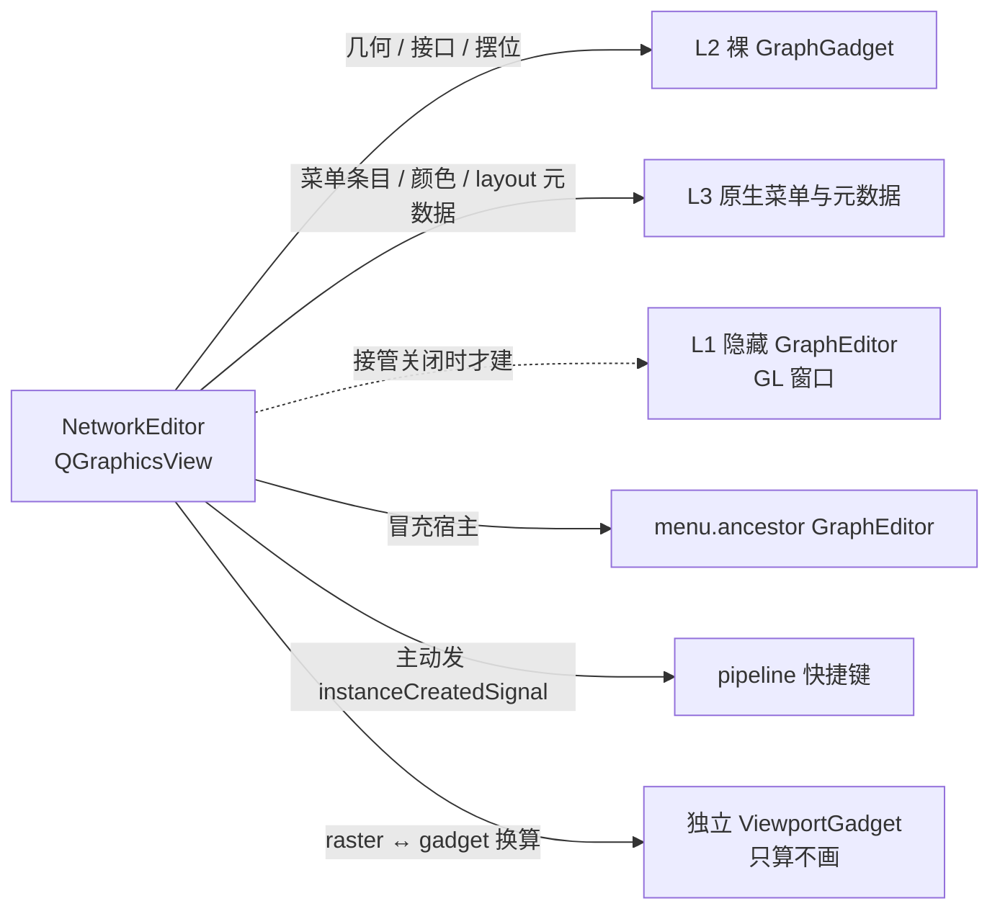

# 设计原则与对比

本文说明 NetworkEditor 的设计原则、它和 Gaffer 自带 GraphEditor 的差别、对原生实现依赖到什么程度，以及已知差异、风险和还没做的部分。所有结论都在 Gaffer 1.7.1.0 上实测，1.6 不再支持。

## 目录

- [动机](#动机)
- [设计原则](#设计原则)
- [为什么不改原生 GraphEditor](#为什么不改原生-grapheditor)
- [和原生共用同一套数据](#和原生共用同一套数据)
- [依赖原生到什么程度](#依赖原生到什么程度)
- [接管 GafferUI.GraphEditor](#接管-gafferuigrapheditor)
- [和 Gaffer 自带 GraphEditor 的对比](#和-gaffer-自带-grapheditor-的对比)
- [性能](#性能)
- [界面语言](#界面语言)
- [已知差异](#已知差异)
- [风险](#风险)
- [还没做](#还没做)

## 动机

Gaffer 自带的 GraphEditor 是一个 OpenGL 视图，外观上能调的只有节点颜色、形状、宽度、留白和图标。要在显示效果和信息密度上做实质改动（类型图标、常驻参数名、圆角连线、按缩放分档的细节），只能另做一个 Qt 视图。NetworkEditor 就是这个视图：layout 里多一个编辑器类型，Gaffer 自带的 GraphEditor 不替换、不修改，两者可以同时开着。

## 设计原则

1. **UI 自己画，几何和配色问原生要。** 节点尺寸取 `nodeGadget.bound()`，接口位置取 `nodule.transformedBound()`，出射方向取 `connectionTangent()`，节点颜色读 `nodeGadget:color`，接口颜色读 `nodule:color`，其余照 `StandardStyle` 的默认色。两个视图同开时节点一样大、接口在同一条边、颜色一致；别人给自定义节点设的 `minWidth` / `padding`、自定义 NodeGadget 也会自动跟上。
2. **所有数据存在 Gaffer 原来的位置。** 节点位置、Backdrop 框、连线折叠、选择、focus、书签、注释、只读，全部读写 Gaffer 已有的字段。在哪个视图里改，另一个立刻跟上；`.gfr` 里不写任何自定义数据，没装本扩展的人一样能打开。
3. **原生已经实现的行为直接复用。** 节点创建、自动连线与摆位、三套右键菜单（节点 / 插口 / 连线）、从 Viewer / HierarchyView 拖路径建 PathFilter 与 SetFilter、`Ctrl+F` 查找对话框，都是 Gaffer 自带的实现。官方、第三方插件和工作室 pipeline 挂在这些扩展点上的条目自动可用，以后新增的也自动跟上。

目标：看起来更现代，用起来和原生没有区别。

## 为什么不改原生 GraphEditor

原生 GraphEditor 是 OpenGL 加一段写死的 GLSL shader（`src/GafferUI/StandardStyle.cpp` 里那段字符串），只支持纯色填充、一档圆角、一种深色描边和纹理贴图，没有渐变、阴影、多层描边、任意字号字体和 SVG。

`Style`、`GraphGadget`、`GraphLayout` 三个类在 Python 绑定里都没有 wrapper（`StyleBinding.cpp` / `GraphGadgetBinding.cpp` 用的是 `RunTimeTypedClass` / `GadgetClass`），不能从 Python 子类化。在原生视图里能动的只有 5 个元数据旋钮（`nodeGadget:color` / `shape` / `minWidth` / `padding` / `icon`）和 `StandardStyle` 的 8 个全局颜色。

「用 Qt 画好卡片再贴成 GL 纹理」这条路也不可行：每个节点一张贴图，节点一多显存和上传开销就失控。

`QGraphicsScene` 是矢量的，缩放不糊、不用贴图，自带 BSP 索引和视口裁剪，适合做这个视图。

## 和原生共用同一套数据

| 内容 | 存在哪 |
| --- | --- |
| 节点位置 | `node["__uiPosition"]`（`V2fPlug`，Dynamic；节点中心，y 向上） |
| 连线折叠 | `node["__uiInputConnectionsMinimised"]` / `__uiOutputConnectionsMinimised` |
| Backdrop 框 | `node["__uiBound"]`（`Box2fPlug`） |
| 选择 | `script.selection()` |
| focus | `script.getFocus()` |
| 书签 / 注释 / 只读 | `Gaffer.MetadataAlgo` |

节点尺寸和接口位置来自一个裸的 `GafferUI.GraphGadget( script )`（`__graphGadget()`），它只当尺子用，不显示、不建 widget，实测也不会去建 `__uiPosition`（那是 GraphEditor 渲染时才做的事）。

Tab 面板是自己的 UI，但创建函数是从 `NodeMenu.nodeCreatorWrapper` 的闭包里取出来的原生 `nodeCreator`（`_unwrapNodeCreator`），之后的 `connectNode` / `positionNode` 仍走原生 `StandardGraphLayout`。`Box` / `Backdrop` / `Reference` / 部分图像滤波节点注册的是 `nodeMenuCreateCommand( menu )`，创建函数自己要 `menu` 参数、拆不出来：做法是现造一个不弹出来的 `GafferUI.Menu`，把它的 `_Menu__popupParent` 指到菜单宿主上，命令里的 `menu.ancestor( GafferUI.GraphEditor )` 就能拿到东西（`__createWithCommand`）。面板里不存在「退回原生 Tab 菜单」这条路，避免用户刚打完 `box` 又要在原生搜索框里重打一遍。

## 依赖原生到什么程度

### 三层依赖

「原生」拆开看有三层，只有第一层是真正的窗口：

| 层 | 是什么 | 拿它干什么 | 是不是窗口 |
| --- | --- | --- | --- |
| L1 隐藏 GraphEditor（`__engine()`） | 一个从不显示的原生 GraphEditor，带 GL `GadgetWidget` | ①原生右键菜单命令要 `menu.ancestor( GafferUI.GraphEditor )` 当宿主；②创建函数自己要 `menu` 的节点；③工作室 pipeline 通过 `GraphEditor.instanceCreatedSignal` 注册的快捷键（例如 S / Q 菜单），要有一个 GraphEditor 实例才生效 | 是（建一个约 7.7 ms，真的会建 QOpenGLWidget） |
| L2 裸 GraphGadget（`__graphGadget()`） | `GafferUI.GraphGadget( script )`，纯 C++ 对象 | 节点尺寸、接口位置、`+`（PlugAdder），新节点的自动连线与摆位（`StandardGraphLayout`） | 不是（建它约 0 ms，不要 widget 和 GL 上下文） |
| L3 原生菜单内容与元数据 | 借来的 `MenuDefinition`、`nodeGadget:color` / `nodule:color` / `layout:*` | 官方、第三方、pipeline 挂上去的条目直接可用 | 不是 |



### 继续借原生的好处

1. **别人的扩展点自动生效**：右键菜单条目、`toolMenuSignal`、`instanceCreatedSignal` 上的快捷键，不用逐条重写，也不用追着别人更新。
2. **和原生视图数值一致**：两个视图同开时节点大小和接口位置分毫不差。
3. **少维护一大块语义**：自动连线、摆位、`Box.create` 把选中节点装进去这类行为。
4. **升级 Gaffer 时新功能直接可用**，例如 1.7 的多选右键菜单。

### 代价

1. 依赖私有 API：`_Menu__popupParent` / `_Menu__popupPosition`、「命令要不要 `menu` 参数」的判据、接管用的元类，全都版本敏感。
2. 原生命令里任何 `graphEditor.*` 调用，接口面都由别人定、由我们兜。
3. 借来的命令可能反过来建原生编辑器：原生 `Show Contents...` 会现建一个 GraphEditor 塞进 layout，所以这条命令在借来的菜单里被就地换成本编辑器的进层级（`insertBefore` 保持原位）。

### 依赖面是量出来的

两个开关专门用来量依赖：

| 开关 | 效果 | 无头测试结果 |
| --- | --- | --- |
| `GAFFER_NETWORK_EDITOR_ENGINE=0` | 不建隐藏引擎（接管提前装上） | 只挂 3 条，全是接管那一节自己的前置断言（「接管前 `GafferUI.GraphEditor` 是原生类」之类），功能上已不需要 L1 |
| `GAFFER_NETWORK_EDITOR_GADGET=0` | 不问原生几何，走公式回退 | 挂 6 条：新节点没有位置（自动摆位是 `StandardGraphLayout` 给的），接口位置差几像素（ours `[-21.33, 0, 21.33]` vs native `[-21.6, -7.2, 7.2]`） |

量 `ENGINE=0` 时接管必须提前装：生产环境里 startup 就装了，测试文件里接管装得晚，直接跑会把「接管还没装、宿主退回引擎、引擎又被关掉」的那些节也算进去。早装的量法是先 `installGraphEditorTakeover( force = True )` 再 `exec` 测试文件。

### 摆脱 L1 的做法

要摆脱的只有 L1。L2 不是窗口，留着几乎没有成本，还换来数值一致。目标是「一个原生 GraphEditor 实例都不建」，原生代码照样用。

原生命令要 editor 提供的东西，照源码列全只有 5 个方法加 1 个 widget 契约：

| 命令 | 出处 | 调 editor 的什么 |
| --- | --- | --- |
| `NodeMenu.nodeCreatorWrapper` | `NodeMenu.py:98-150` | `graphGadgetWidget()`、`graphGadget()`（`getRoot()` / `getLayout().connectNode` / `positionNode`）、`scriptNode()`、`frame( [ node ], extend = True )`，外加 `menu.popupPosition( relativeTo = gadgetWidget )` 和 `getViewportGadget().rasterToGadgetSpace(...)` |
| `DotUI.__insertDot` | `DotUI.py:136` | 同上前四样 |
| `BoxUI.nodeMenuCreateCommand` | `BoxUI.py:115` | `scriptNode()`、`graphGadget()` |
| `BackdropUI.nodeMenuCreateCommand` | `BackdropUI.py:50` | 同上加 `graphGadgetWidget()` |
| `ReferenceUI.nodeMenuCreateCommand` | `ReferenceUI.py:79` | `graphGadget()` 加 `ancestor( GafferUI.Window )` |

四步做法：

| 步 | 做什么 | 依据 |
| --- | --- | --- |
| ① 自己当宿主 | 接管装好后 `isinstance( ourEditor, GafferUI.GraphEditor )` 为真（元类 `__instancecheck__`）。把菜单的 `_Menu__popupParent` 设成 `weakref.ref( self )`（`Menu.parent()` 解的是弱引用，`Menu.py:131-138`），`menu.ancestor( GafferUI.GraphEditor )` 就返回我们。`__menuHost()` 在接管装着时返回自己、没装时退回引擎；`__hostPopupPosition()` 给出图坐标在屏幕上的真实位置；`__hostSignal()` 在宿主是自己时只用类级信号 | `Widget.ancestor()` 就是沿 `parent()` 链做 `isinstance`（`Widget.py:415-423`） |
| ② 壳替代 `graphGadgetWidget()` | `_GadgetWidgetShim` 只实现 `getViewportGadget()` / `bound()` / `size()` / `_qtWidget()`；`getViewportGadget()` 返回 `_syncedViewport()` 给的独立 ViewportGadget | 独立 `ViewportGadget` 在无窗口、无 GL 下 `rasterToGadgetSpace` 照常工作 |
| ③ 快捷键由自己发信号 | `__announceInstance()` 在接管装着时主动发 `GafferUI.GraphEditor.instanceCreatedSignal()( self )`，pipeline 的 handler 直接连到本编辑器的 `keyPressSignal`；`_forwardShortcutKey` 先发给自己，没人接且确实有引擎时才退回引擎 | `Editor.instanceCreatedSignal` 是按类的 `Signal1`，`Editor.__init__`（`Editor.py:240`）本来就是沿类层级发的 |
| ④ 默认不建引擎 | `engineEnabled()`：接管装着就不建（`=1` 强制建、`=0` 强制不建）；`graphEditorTakeoverInstalled()` 判断接管状态 | 关掉引擎再按 pipeline 注册的 `S`，照样接住、照样弹本编辑器的面板 |

`_GadgetWidgetShim` 故意不做成 `GafferUI.Widget`：`Widget.__init__` 会登记全局 owner 表并设 `WA_StyledBackground`，壳不需要这些。

两条实测约束：

- 一个 gadget 只有一个父。把借来的 GraphGadget 挂给第二个 ViewportGadget 会把它从原来的父上抢走，所以绝不挂真 GraphEditor 的 gadget。
- `rasterToGadgetSpace( gadget = X )` 对不在树里的 X 给同样答案（顶层变换是单位矩阵），不必和原生共用 gadget 对象。

### ViewportGadget：只算不画的取景器

Gaffer 的 GL 场景图和 Qt 对照着看：

| Gaffer | Qt 里的对应物 | 说明 |
| --- | --- | --- |
| `Gadget` | `QGraphicsItem` | 能画、能收事件的一个对象 |
| `GraphGadget` | 装满节点卡片的那一层 | 节点、连线、`+` 都是它的子 gadget |
| `ViewportGadget` | `QGraphicsView` 的那套变换（相机） | gadget 树的根加一个相机：视口多少像素、看着图的哪一块，负责像素和图坐标互换 |
| `GadgetWidget` | `QGraphicsView` 控件本身 | 真正的 QWidget，GL 在这一层 |

原生 GraphEditor 就是这么搭的（`GraphEditor.py:107-116`）：`ViewportGadget()` → `setMaxPlanarZoom( 25 )` → 塞进 `GadgetWidget` → `setPrimaryChild( GraphGadget )`。

原生摆位只问它一件事：「这个像素是图里的哪个点」。所以只要让这个相机看到的范围等于 `QGraphicsView` 当前看到的范围，答案就和用户眼睛看到的一致：

```python
def _syncedViewport( self ) :

    if self.__viewportGadget is None :
        self.__viewportGadget = GafferUI.ViewportGadget( self.__ownGraphGadget() )

    qtViewport = self.__view.viewport()
    self.__viewportGadget.setViewport( imath.V2i( qtViewport.width(), qtViewport.height() ) )

    visible = self.__view.mapToScene( qtViewport.rect() ).boundingRect()   # scene 像素
    px = PX_PER_UNIT
    self.__viewportGadget.frame( imath.Box3f(                              # Gaffer 单位，y 翻转
        imath.V3f( visible.left() / px, -visible.bottom() / px, 0 ),
        imath.V3f( visible.right() / px, -visible.top() / px, 0 ),
    ) )
    return self.__viewportGadget
```

（上面是示意，实际实现按整个编辑器的范围取景：原生 `EditMenu.paste` 拿编辑器 `bound()` 算 raster，只按视口算会差一个工具条高度。）

四条实测性质：

1. 默认是 2D 相机（`getPlanarMovement() == True`），默认视口 `V2i( 640, 480 )`。不 `setViewport` 就按 640x480 算，视口退化时原生摆位会算出 `nan`。
2. `frame( box )` 把整个框装进视口，宽高比不同时往长边扩。喂进去的框来自 `mapToScene( viewport.rect() )`，天生和视口同宽高比，结果精确。
3. 改视口尺寸不会自动重新取景，所以每次用之前同步一次 `setViewport` + `frame`。
4. y 轴方向相反：raster 是 y 向下，gadget 是 y 向上。`rasterToGadgetSpace` 返回 `LineSegment3f`，取 `.p0`。

实测精度：拿节点做往返（Gaffer 位置 → 本编辑器算 raster → 原生 `rasterToGadgetSpace` 回算），误差 0.013 ~ 0.022 单位（约 0.25 px，来自 raster 取整），视口正中完全一致。

### 现状

生产默认（接管开着）下一个原生 GraphEditor 实例都不建，每个编辑器省一个 QOpenGLWidget 和约 7.7 ms。引擎相关代码保留，作为接管关闭时的退路。L2 裸 gadget 一直保留。

## 接管 GafferUI.GraphEditor

官方代码里有几处写死了 `GafferUI.GraphEditor`：`EditMenu.scope()`（菜单栏剪切 / 复制 / 粘贴 / 删除作用在哪一层）、`GraphBookmarksUI`（书签跳转）、`NodeFinderDialogue`（`Ctrl+F`）、`BoxUI` 的 `Show Contents...`。`registerEditor()` 时自动装上接管（`installGraphEditorTakeover()`），`GAFFER_NETWORK_EDITOR_TAKEOVER=native` 关掉。

做法是把 `GafferUI.GraphEditor` 换成一个由元类实现的壳，它只改「找编辑器」这一件事：

| | 接管后 |
| --- | --- |
| `isinstance( x, GafferUI.GraphEditor )` | 对本编辑器和原生编辑器都为真，原生编辑器不受影响 |
| 类属性（`plugContextMenuSignal` 等） | 一律转给原生类：startup 里的 `connect()` 早挂在原生类上，必须是同一个信号对象 |
| `GafferUI.GraphEditor( script )` | 仍然构造原生的：已存的 layout 里写死的就是这一句，换掉会让旧布局悄悄变样 |
| `acquire( node )` | 优先用 layout 里已有的 NetworkEditor 进那一层，没有才退回原生 |

本编辑器上补齐了原生命令会用到的方法：`graphGadget()`（一律给自己的裸 gadget，并连 `rootChangedSignal` 跟着换层，pipeline 快捷键里 `graphGadget().setRoot()` 这类调用因此能驱动本视图）、`graphGadgetWidget()`（返回壳）、`frame( nodes, extend )`（落到自己的视图），以及 1.7 需要的 `plugContextMenuSignal()` / `connectionContextMenuSignal()` / `nodeContextMenuSignal( multiNode = False )`（签名照 `GraphEditor.py:205/216/264`）。

1.7 在两处扩展点上会打破只按 1.6 写的实现：

- **`_PlugVisibilityGadget`**：1.7 新增，`startup/gui/editor.py` 对每个 Editor 调 `connectToEditor`，它的闸门是 `isinstance( editor, GraphEditor )`，接管装着时本编辑器也满足，它接着要实例上的 `plugContextMenuSignal()` / `nodeContextMenuSignal( True )`。缺这两个信号时编辑器构造直接失败，所以实例级的四个 `Gaffer.Signals.Signal3()` 必须有。
- **节点右键菜单整套搬到多选那一路**：`/Edit...` `/Enabled` `/Connections` `/Focus` `/Show Contents...` `/Bookmarked` 和注释都注册在 `nodeContextMenuSignal( True )` 上（参数是节点列表），原生 `__buttonPress`（`GraphEditor.py:487-490`）发它时没有「选了几个」的守卫。单选右键也必须发多选那一路，否则菜单整个是空的。

`NetworkEditor.__getattr__` 是诊断钩子：有人问了本编辑器没有的属性时记一条 Debug 日志，再照常抛 `AttributeError`。把日志级别调到 Debug、拿实际场景把菜单点一遍，缺什么一目了然。

## 和 Gaffer 自带 GraphEditor 的对比

### 显示效果与信息密度

| | Gaffer 自带 | NetworkEditor |
| --- | --- | --- |
| 节点信息 | 颜色和名字，只有少数官方节点有图标 | 每个节点一枚矢量类型图标（材质 / 相机 / 过滤器 / 图像 / 几何 / 坐标系等）；灯光按类型分九种（点 / 平行 / 面 / 聚光 / 圆盘 / 圆柱 / 穹顶 / 光度学 / 网格光），照官方 LightEditor 的图标复刻，渲染回 16x16 和原 PNG 逐像素对比 |
| 材质节点参数 | 只有圆点，参数名要悬停才出 | 参数名常驻写在卡片里（Houdini 那样），按 `layout:section` 分栏，默认收起，点小三角或栏名行展开 |
| 缩放 | — | 矢量绘制，任意缩放都清晰；按缩放分档（`LOD_MEDIUM = 0.18` 以下只画色块，`LOD_NEAR = 0.75` 以上画全部细节） |
| 连线 | 直线 / 贝塞尔 | 照 Houdini 的 rounded 样式重做（直段加正圆弧），按接口类型色上色，长线中段渐隐；穿过两端卡片时改走横平竖直的绕行折线 |
| focus | 把不参与计算的部分压暗 | 照原生压暗（同一个 `ContextTracker`），另在卡片外画一个折角，拉到最远也认得出 |
| 接口圆点 | 按插口类型上色 | 同样的 `nodule:color`；悬停半径翻倍、高亮，tooltip 写参数名、方向、类型、接没接上和 `description` |

连线和 Houdini 的对比有基准数据：`tests/houdini_rounded_wire.json` 存了 Houdini 21.0 真机采集的 5 个用例、每个 45 个采样点，测试直接量本编辑器的路径离 Houdini 那条线多远，平均 1.7 px、最大 7.1 px（约 200 px/单位的缩放下）。拐角圆拟合残差约 0.005 单位（约 1 px），说明 Houdini 用的确实是正圆弧。

### 查找与创建节点

| 功能 | Gaffer 自带 | NetworkEditor |
| --- | --- | --- |
| 建节点（`Tab`） | 单列菜单，按分类逐级点，子串搜索 | 级联多列面板，一列一个窗口；搜索按证据强度分档（名字前缀 → 首字母缩写 → 缩写前缀 → 词中命中 → 按词头分段 → 子序列），打 `ass` 出 `aiStandardSurface`；名字不截断、列宽跟内容走；顶部有「★ 喜爱」和「常用」 |
| 找书签（`B`） | 递归列出全图书签，可搜索菜单 | 同一套可搜索面板，选一条就切到那一层并框住；递归查找用 `Metadata.nodesWithMetadata( script, "bookmarked", instanceOnly = True )`（`MetadataAlgo.bookmarks()` 只扫直接子节点） |
| pipeline 快捷键 | 通过 `GraphEditor.instanceCreatedSignal` 注册（例如 S / Q 菜单） | 全部可用；会弹菜单的那几个转成同一套可搜索面板，分组分列、带勾选状态 |
| 看参数 | 双击开浮动 NodeEditor | 同样支持；另有 `P` 键在视口右上角停靠一块纯参数面板（需要单独的参数面板扩展 `parameterEditor`），跟着选择走，边框可拖着改大小 |

「★ 喜爱」和「常用」记在用户主目录下的 `.gaffer_network_editor`（`GAFFER_NETWORK_EDITOR_STATE_DIR` 可改），不进 `.gfr`。

### 快捷键

和原生一致的部分逐条照 `GraphEditor.__keyPress`、`EditMenu`、`GraphBookmarksUI`：

| 操作 | 效果 |
| --- | --- |
| 左键点 / `Shift` / `Ctrl` | 选中 / 加选 / 取消选中（点已选中的不清空，方便拖整组） |
| `Alt+Shift` / `Alt+Ctrl` 点 | 连同上游 / 下游一起选 |
| 左键拖节点 | 移动，一次拖动一步撤销；单个节点压到连线上松手 = 塞进那根线（判据同原生 `dragReconnect`） |
| 左键拖接口 | 建连接，照原生 `closestDragDestination` 挑最近的、接得上的接口 |
| 拖连线到 `+` | 提升插口、给 Switch 加一路、给材质挑参数（原生 PlugAdder 语义） |
| 中键拖节点 | 把节点拖给别的编辑器（原生 `Sending` 模式） |
| 双击节点 | 打开浮动 NodeEditor（发 `nodeDoubleClickSignal`） |
| `F` / `` ` `` / `Ctrl+` `` ` `` | 适应视图 / 框住 focus / 把选中的设成 focus |
| `↓` / `Shift+Ctrl+↓` / `↑` / `[` `]` | 进入 / 进入（不可看的节点）/ 回上一层 / 层级历史 |
| `D` | 停用 / 启用选中节点 |
| `1`–`9` / `Ctrl+1`–`9` / `Ctrl+0` | 跳到 / 设置 / 清掉编号书签 |
| `Delete` / `Backspace` | 删除选中节点，上下游自动接起来 |
| `Ctrl+C` / `Ctrl+X` / `Ctrl+V` / `Ctrl+D` | 复制 / 剪切 / 粘贴 / 连输入一起复制 |
| `Ctrl+A` / `Shift+Ctrl+A` | 全选 / 全不选 |
| `F2` / `Ctrl+F` | 改名 / 查找节点（原生 `NodeFinderDialogue`） |
| 从 Viewer / HierarchyView / SetEditor 拖进来 | 建 / 改 PathFilter 与 SetFilter（`Shift` 追加、`Ctrl` 去掉）；落在空白处跳到生成该位置的节点 |
| 拖文件进来 | 建对应的读取节点，摆在落点 |
| 拖到视口边缘 | 画面自动滚动（照 `ViewportGadget::trackDrag`） |

`Ctrl+Z` / `Ctrl+Shift+Z` 走 ScriptWindow 菜单栏的全局快捷键，本编辑器不拦。`Ctrl+C/X/V/D`、`Delete`、`Ctrl+A`、`Ctrl+L`、`F2`、`Ctrl+F` 必须在 `ShortcutOverride` 阶段截下来，否则菜单栏上同名的 QAction 会先抢走，而 `EditMenu.scope()` 进 Box 后会拿错 parent。

新增的部分：

| 操作 | 效果 |
| --- | --- |
| `X` | 删除模式（开关式）：点连线断线、点节点删节点并重连上下游，按住左键划一笔切多根；再按 `X` / `Esc` / 右键退出 |
| 工具条 Snap（默认开） | 拖动自动对齐：只在 `SNAP_RANGE`（360 px）内找、只吸最近那一个能横平竖直对上的节点（`SNAP_DISTANCE` 8 px）、只吸一个轴，参考线只画在两节点之间 |
| 连线吸附 | 拖线靠近节点时吸到最近的、接得上的接口（`CONNECT_SNAP_DISTANCE` 26 px），圆点放大高亮；连线两端可拖着改接，丢空白处即断开 |
| `Alt+右键` 拖 | 缩放，照 `ViewportGadget` 的 dolly：`zoom = 起始 zoom * exp( 1.9 * d )`，围着按下那一刻光标下的点缩 |
| `P` | 纯参数面板（见上） |
| `Ctrl+L` | 自动排列换成自己的分层布局（见下） |
| 工具条 Curved / Straight | 连线样式切换 |

### 自动排列

我们的布局本来就是 Sugiyama 那套四步（分层 → 长边打桩 → 定序 → 定位），外加主干拉直。每一步都做成可换的实现（`LAYOUT_STRATEGY`，临时换用上下文管理器 `layoutStrategy()`）：

| 键 | 可选 | 默认 |
| --- | --- | --- |
| `rank` | `longest-path` / `network-simplex`（Graphviz `dot` 那套）/ `alap` | `longest-path` |
| `order` | `barycenter` / `median` / `dfs` / `dfs-barycenter` / `dfs-median` | `barycenter` |
| `position` | `median` / `brandes-kopf` / `tidy` | `brandes-kopf` |
| `spine` | `pin` / `align` / `align+pin` / `off` | `align+pin` |

对照台 `tests/bench_layout.py` 用 12 张图（7 张合成的：场景流水线 / 一个 filter 喂五个 / filter 串链 / 36 个 OSLCode 的稠密材质图 / 稠密菱形 DAG / 宽扇出 / 长链；另外 5 张来自一份真实材质文件里的每个 Box），每种组合各排一遍，量交叉数、连线总长、长边直不直、主干直不直、输入口顺序、耗时，原生 `StandardGraphLayout` 一起跑当参照。12 张图共约 200 个节点：

| 组合 | 交叉 | 总长 | 长边直 | 主干直 | 输入口乱序 | 耗时 |
| --- | --- | --- | --- | --- | --- | --- |
| `brandes-kopf` + `align+pin`（默认） | **174** | 6888 | **32/80** | **80/80** | 7 | 85.9 ms |
| `median` + `pin` | 191 | 6891 | 17/80 | 80/80 | 4 | 83.9 ms |
| `brandes-kopf` + `align` | 165 | 6792 | 31/80 | 76/80 | 9 | 84.0 ms |
| `brandes-kopf` + `pin` | 187 | 6901 | 20/80 | 80/80 | 5 | 84.2 ms |
| `network-simplex` + `brandes-kopf` + `align+pin` | 174 | 6799 | 32/80 | 80/80 | 7 | 86.6 ms |
| `alap` + `dfs` + `tidy`（Houdini 风格） | 195 | 7021 | 19/82 | 80/80 | **3** | **65.1 ms** |

- Brandes–Köpf 定位：交叉 −8.9%，长边直的条数 +88%，耗时不变。收益几乎全在稠密材质图上（36 个 OSLCode 那张交叉 63 → 44、直边 8 → 21），场景流水线基本持平。它先决定谁和谁必须对齐成一个 block 再整块摆，长边的桩链天然落进同一个 block，画出来是直线。
- 网络单纯形分层：连线总长只少 1.3%、交叉一个不差，600 节点稠密图要多花 5 秒，默认不开；`LAYOUT_SIMPLEX_NODE_LIMIT = 250` 超过自动退回最长路径。
- 中位数定序和重心法在 12 张图上逐项完全相同（层内节点少、邻居也少），保留作对照。
- Houdini 风格（贴着消费者分层 + 按插口顺序深度优先 + 树式定位，不做交叉优化）交叉最多、连线最长，但输入口顺序保持最好、速度最快；「`in0` 一定在 `in1` 左边」这条长处单独保留为 `order = "dfs*"`。
- 主干拉直：只 `pin` 会把 BK 压紧的结果搅乱（交叉 165 → 187）；先 `align`（主干那条边作为 BK 的优先对齐候选）到 76/80，再补一次 `pin` 到 80/80。
- 12 张图里有 8 张所有组合完全打平，差异集中在稠密材质图上。

一张 44 节点的真实材质图上，连线交叉比原生自动排列少约三成，且没有逆流的连线。

两处 Gaffer 特有的判据比算法本身更影响结果：

1. **流向判定（`nodeFlowAxis`）**：场景 / 图像节点的 `out` 挂下边，材质的 `out` 挂右边，按输出圆点所在的边判定流向；一个输出圆点都没有时才看输入。只看「有没有输入挂上边」会把 `OSLCode`（`code` 在上边）和 `ArnoldDisplacement`（`map` / `height` 在上边）误判成场景节点，36 个 OSLCode 的图会散成 35 组、161 处交叉；改正后 1 组 63 处（再换 BK 是 44 处）。`isFlowEdge` 另有兜底：节点在流向那两条边上没有输入圆点时，它挂在哪儿哪儿就是主流。
2. **从侧面喂进来的节点（PathFilter 这类）**：挡路判定按逐个节点的矩形算（按整组包围盒算会让 filter 越过整条主干，平均侧跳 99.8 → 25.5 单位，原生 14.6）；判断「撞上没有」用 `LAYOUT_CLEAR_GAP = 1`、推开用 `LAYOUT_GROUP_GAP = 6`（两者共用一个间距时，主干两侧相邻的 filter 会互判相撞、一个接一个往外让，侧跳 17 / 34 / 17 / 34 / 51 → 全部 17.3）；一个 filter 喂几个节点时，挂钩方向取最外面那个、垂直方向取平均。

数交叉用树状数组数逆序对（替换两重循环），300 节点稠密图这一项 4.9 s → 1.2 s，换之前拿两重循环版对 200 组随机图逐组比对一致。

## 性能

### 增量更新

改一根线、加一个节点都走增量，只有换 root 和第一次显示才全量重建。全量重建 63% 的时间花在逐个建节点 item（每个都要问原生 gadget 要尺寸、接口、`+`），没变的节点不需要重建。

| 图规模 | 全量重建 | 只做 diff | 再去掉每次编辑的 O(N) |
| --- | --- | --- | --- |
| 200 | 58 ms | 22 ms | **5.3 ms** |
| 800 | 240 ms | 20 ms | **4.6 ms** |
| 2000 | 689 ms | 44 ms | **4.7 ms** |

最后一列和图大小无关，说明编辑成本已经是 O(改动量)。作为参照，原生的数据层是 0.08 ms（C++ 里给 gadget 标脏，绘制交给 GPU），剩下的差距是 Python 和逐 item 光栅化的常数，编辑操作上感觉不到。

去掉的 O(全图) 操作：

| 以前每次编辑都做 | 现在 |
| --- | --- |
| `collectNodes( root )` 扫全图（2000 节点 9.3 ms） | 只改线时一次都不扫，用现有的 item 索引 |
| focus / 参与计算状态扫全图（9 ms） | 只在有新 item 时做；focus 和 ContextTracker 自己变化走各自的信号 |
| 每次 `setSceneRect()` | 包围盒没变就不设（`setSceneRect` 会让整个视口失效） |
| 整个视口重绘 | `SmartViewportUpdate` + `CacheBackground`，只重绘脏矩形 |

300 节点、全景取景下改一根线：节点重绘 300 → 18、连线重绘 275 → 30、`collectNodes` 1 → 0；闲着不动时全为 0。这些次数写成了断言，时间换台机器会变，次数不会。

信号怎么分：

| 信号 | 标什么脏 | 做什么 |
| --- | --- | --- |
| root 上的 `childAdded/Removed` | 结构 | 节点集合 diff + 边整体对一遍 key |
| `nameChanged` | 结构 + 那个 item | item 按名字存，改名等于换一个 |
| `plugInputChanged` | 目的地那个节点的边 | 只重收以它为终点的边；key 没变就一个 item 都不动 |
| 节点的 `childAdded/Removed` | 那个 item | 提升插口 / `setup()` 让接口变了；只连会长子插口的直系插口（`plugMayGrowChildren`） |
| 元数据 / `enabled` / `__uiBound` | 那个 item | 形状、颜色、尺寸可能都变 |
| `__uiPosition` | 那几个节点（`__dirtyPositions`） | 只挪那几个；连线由 `itemChange` 跟着算 |

几个必须注意的点：

- 动 item 期间要屏蔽 scene 信号，否则删掉一个选中 item 会发 `selectionChanged`，被当成用户改了选择写回 script。
- 接一根 `ScenePlug` 的线，`plugInputChangedSignal` 会沿下游链响 87 次（子插口的 pass-through 被重接一遍），但画出来的边一条没变，所以先比 key。
- `ArrayPlug` 长出一路只有 `plugInputChangedSignal`，信号不说多了接口，要对接口布局指纹。
- 拖动期间绝不重建：重建会删掉 item，Qt 的隐式鼠标抓取跟着丢，这一下拖动静默失效。

### 每帧重画的开销

一帧里 `paint()` 被调的次数和视口内 item 数之比实测是 1.00（2000 节点全景 2000 / 2000，日常缩放 756 / 756），Qt 的 BSP 索引和视口裁剪工作正常，做视口虚拟化省不到绘制时间。把平移从 `translate()` 改成动滚动条也没有位图滚动可捡，三种方式 paint 次数相同。

平移一帧的构成（2000 节点、0.36 倍、视口内 276 个节点，起点 18.72 ms）：

| 去掉什么 | 每帧 | 省 |
| --- | --- | --- |
| 不画接口圆点 | 12.86 ms | 31% |
| 不画标题文字 | 12.47 ms | 33% |
| 圆点和标题都不画 | 8.34 ms | 55% |
| 节点完全不画（Qt 合成 + 连线） | 4.54 ms | 76% |

- 给 item 开 `DeviceCoordinateCache` 收益很小（800 节点 11 → 7.3 ms、2000 节点 26.7 → 25.2 ms），代价是每个节点一张 pixmap（2000 节点约 50 MB）且每次缩放全部失效，没开。
- 连线中点箭头的位置缓存在 item 上（`QPainterPath.pointAtPercent` 每次都要做弧长参数化），平移一帧省 18% ~ 23%，收益只跟屏幕上画了多少个箭头有关。
- cProfile 的 tottime 排行会放大 Python 小函数的占比：把几个排名靠前的函数全换成常量后整帧反而没变快。排行只适合用来找调用次数异常或单次很贵的函数。

600 节点图上的热路径（同一台机器）：

| 操作 | 之前 | 之后 |
| --- | --- | --- |
| 空手移动一次鼠标 | 3.3 ms | 0.13 ms |
| 600 个节点全在视口里画一帧 | 74 ms | 51 ms |
| 拉远到色块档画一帧 | 18 ms | 11 ms |
| 首次建 600 个 item | 445 ms | 382 ms |

鼠标移动从 7~9 次 `items()` 查询合成一次探针；`setBspTreeDepth( BSP_TREE_DEPTH )`（16）让 `items( QPoint )` 从 123 µs 降到 23 µs（Qt 自动深度切的是带大余量的整个 sceneRect，整张图挤在一两个叶子里）；节点 item 缓存 `boundingRect` / `shape` / 卡片路径，作废时先 `prepareGeometryChange()` 再清缓存。

## 界面语言

显示出来的文字一律英文（工具条、状态栏、右键菜单、建节点面板、日志），和 Gaffer 其余界面拼在一起不串语言。菜单措辞直接照抄原生：`/Focus`、`/Enabled`、`/Bookmarked`、`/Connections/Show Input Connections`、`/Show Contents...`、`/Collapse … Components`、`/Copy`、`/Cut`、`/Delete`，借来的原生菜单和自己拼的那份用同一套叫法。

鼠标停上去的 tooltip 一律中文，当帮助用：

| 停在哪 | 小框里写什么 |
| --- | --- |
| 工具条按钮 | 这个按钮干什么、快捷键是什么 |
| 状态栏 | 当前层多少节点 / 连线；删除模式时是操作提示 |
| 节点卡片 | 节点名、类型、只读 / 已停用 / 注释 / 出错信息 |
| 参数圆点 | 参数名、输入还是输出、插口类型、接没接上（接上时写上游是谁）、`description` |
| `+` | 拖连线过来会发生什么 |
| 分栏折叠三角 | 点一下展开 / 收起这一栏 |
| 连线 | 两头是谁、是否折叠、怎么选中和改接 |

唯一的例外是 Tab 建节点面板：一个 tooltip 都没有。那个面板的用法是扫着找、找到就回车，划过一行冒一个提示且消失得慢，会盖住下面几行。测试里有反向断言（面板每一行的 `toolTip()` 必须为空）。节点名、注释这类用户自己填的内容照常支持中文。

## 已知差异

### 故意和原生不一致的

1. **框选是擦到就算**，原生要求完全框住。Backdrop 例外，仍要求完全框住，否则在 Backdrop 上框几个节点会顺手把 Backdrop 一起选上、一拖整组搬走。
2. **注释默认只画 `user` 那一类**。原生默认 `"*"`，而 Arnold 材质上的 `shader_type` 不是注册过的模板（1.7.1.0 注册的只有 `performanceMonitor:*` 和 `contextMonitor`），所以原生会在每个材质节点下写一行 `standard_surface`。工具条的 Annotations 菜单可切成全部（`All` / `Other` / 逐个挑）。
3. **接口标签水平画**在圆点外侧，原生按连线切线转角度、太竖时掰成 45° 斜着画（`StandardNodule::renderLabel`）。
4. **focus 额外画一个卡片外的折角**，原生只压暗不参与的部分。压暗的集合和颜色照原生（`ContextTracker.acquireForFocus()`、`StandardStyle::colorForState`）。
5. **材质节点参数名常驻写在卡片里**，原生只在悬停或勾了菜单时显示。
6. **灯光节点不走分栏卡片样式**，用标准卡片。
7. **插口上的 `connectionGadget:color` 元数据不读**。原生 `StandardConnectionGadget` 用它覆盖连线颜色（`StandardConnectionGadget.cpp:710`），本编辑器的连线统一按接口类型色。

### 实现方式不同、效果一样的

- **Backdrop 层叠**：原生用 GL 深度缓冲（`depth` 插口划区间加面积 remap），这里换算成 `zValue`，顺序一致。
- **文件拖放**转发给原生 `graphGadget` 建节点（扩展名到节点类型的映射是原生 startup 里的私有表），本编辑器只负责把新节点摆到落点。
- **右键菜单勾选项**：借来的原生 QMenu 由 Qt 画勾；转成本编辑器面板的那些（S / Q / Tab）在名字左边画 `✓`。

## 风险

### 版本敏感

接管和借用原生右键菜单用到了 Gaffer 没有公开承诺的内部接口（`_Menu__popupParent`、`_Menu__popupPosition`、接管元类、命令参数判据），这些用法都在 1.7.1.0 上实测过。升级 Gaffer 时需要跑全套回归。典型的失效表现是某个右键菜单条目点了没反应，或者像 1.7 的 `_PlugVisibilityGadget` 那样在编辑器构造时直接失败。`GAFFER_NETWORK_EDITOR_TAKEOVER=native` 可一键退回不接管。

1.7.1.0 上复核过结论没变的几项：`StandardNodeGadget.bound()` 仍是 11.0000 x 4.1641；`ViewportGadget` 默认仍是 planar、`V2i( 640, 480 )`；Python 包装对象身份仍不稳定（用 `isSame()`，不用 `is`）；`BoxIO.direction()` / `Switch.inPlug()` / `Loop.inPlug()` 仍没有 Python 绑定；`Metadata.value()` 读 `BoolData` 仍解包成 Python bool。1.7 把「能不能进这个节点」的正式键换成 `ui:childNodesAreViewable`，`_childrenViewable` 照原生依次查新旧三个键。

### 重绘区域要自己维护

Qt 只重画 item 自己上报的 `boundingRect()`。画在卡片外的东西（focus 折角、注释、书签编号、Backdrop 选中描边）漏算范围，拖动时就会留拖影。几个必须遵守的规则：

- `boundingRect()` 要算进 pen 宽的一半。
- 按 `1/lod` 放大的绘制（让角标在屏幕上大小恒定）必须夹上限（`FOCUS_LOD_FLOOR`），否则在某个缩放档一定会画到包围盒外。
- 几何变化先 `prepareGeometryChange()` 再改缓存。
- `shape()` 由多个重叠矩形拼成时要 `setFillRule( QtCore.Qt.WindingFill )`，默认的 `OddEvenFill` 会把重叠处异或成洞，表现为点不中。

这类问题自动测试和 `grab()` 看不出来（`grab()` 每次都重新渲染）。验证要抓真实屏幕内容（`screen.grabWindow()`）再和强制 `repaint()` 后的结果逐像素比，这套回归已固化在 `tests/e2e_panel_input.py`。新画任何卡片外的元素时仍需留意。

### 性能上限在 Python 和 CPU 绘制

编辑操作已经和图大小无关，但每帧都要重画的操作（平移、缩放）随视口内节点数线性增长：2000 节点、0.36 倍、视口内 276 个节点时平移一帧 18.72 ms，约 53 fps。极端大图连续平移会比原生 GL 视图慢，几百节点的日常场景感觉不到。再提速只能让每次绘制更便宜。

### 接管全局生效

装上后，官方和第三方代码里打开节点图的调用、Box 的 `Show Contents...` 等落点都变成本编辑器。原生命令实际用到的接口已补齐，`__getattr__` 诊断钩子会记录没预料到的调用。残余风险是某个第三方脚本用到了原生编辑器独有的功能，`GAFFER_NETWORK_EDITOR_TAKEOVER=native` 可关闭接管（代价是右键菜单和 pipeline 快捷键退回由隐藏引擎承载）。

### 其它

| 项 | 说明 |
| --- | --- |
| `P` 键依赖另一个扩展 | 纯参数面板来自 `parameterEditor` 模块，没装时按 `P` 报 `ModuleNotFoundError`，节点图其余功能不受影响 |
| 偏好跟人走 | ★ 喜爱和常用记在用户主目录，不进 `.gfr`，换机器不带；需要漫游时把 `GAFFER_NETWORK_EDITOR_STATE_DIR` 指到共享位置 |
| 两个视图同开 | 行为正确（数据是同一份），但内存和渲染各一份 |
| 无头 / CI 跑法 | 必须设 `QT_QPA_PLATFORM=offscreen`，否则窗口管理器会让几何断言随机失败（`Qt.Popup` 的可见性在真 X11 下不稳） |
| 代码量 | 生产代码约 15k 行（12 个模块）、测试约 14k 行；模块严格分层、无循环依赖，测试里绝大多数断言是次数、几何、结构这类换台机器不变的量 |

## 还没做

- **中间 LOD 档**：`LOD_MEDIUM`（0.18）到约 0.45 之间画出来的名字只有 3.5 ~ 6 px 高，实际读不出来，却占了平移一帧约三分之一的时间。中间再插一档（字小于可读阈值就不画）是剩下唯一明显的绘制收益，属于观感取舍，还没定。
- **6 参数 `QMouseEvent` 构造**：Qt 6.4 起标为 deprecated，6.5 上照常工作，还没换。
- **数据层兜底**：`GAFFER_NETWORK_EDITOR_GADGET=0` 时接口位置走公式，和原生差几个像素；默认路径不受影响，公式回退没有继续追平。

上面「已知差异」里列的条目是有意为之，不在待办之列。
