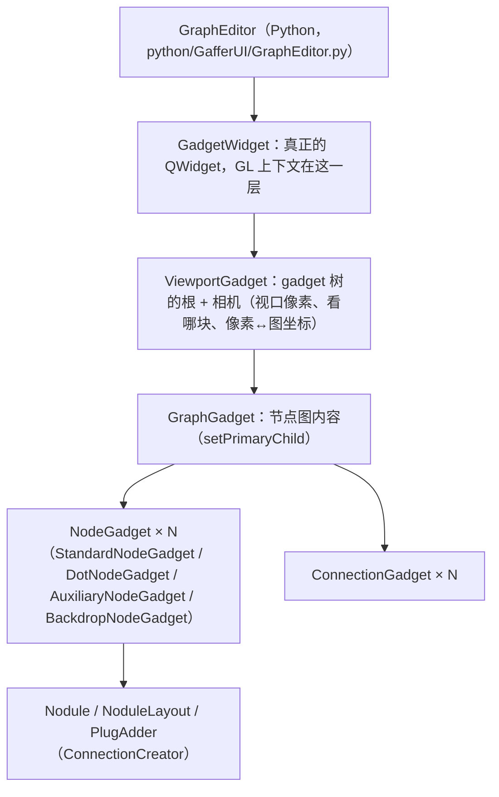
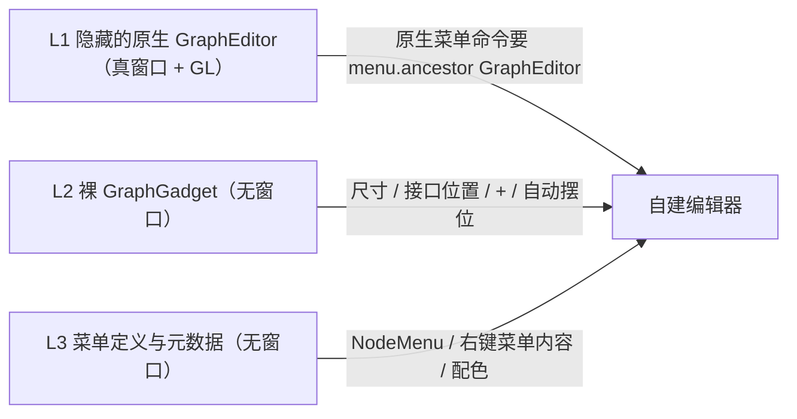
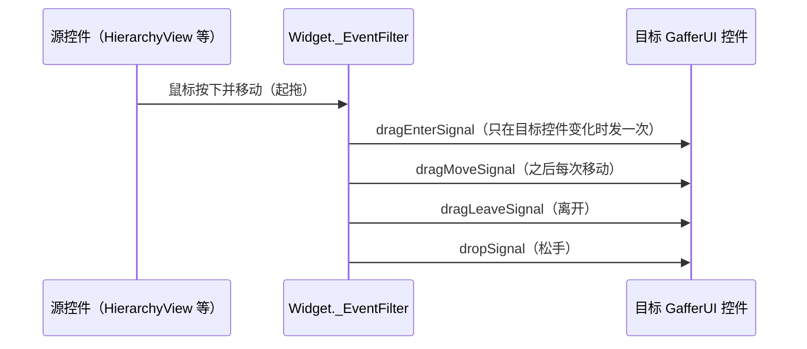

# 做这个编辑器过程中整理出来的 Gaffer 知识

这份文档收的是给 Gaffer 写 UI 扩展时可以复用的事实：原生 GraphEditor 的内部结构、它和别的模块之间的约定、Python 绑定的边界、Qt 在 Gaffer 环境里的行为差异，以及怎么验证一个 UI 扩展真的工作。每一条尽量写明出处（GafferHQ/gaffer 仓库里的文件和行号）和它在本仓库里的用法。

**行号约定**：Python 文件的行号按 Gaffer **1.7.1.0** 发布版核对过；C++ 文件的行号取自 main 分支，版本之间会漂移，以文中给出的函数名为准。版本敏感的 API 一律拿自己装的那个版本的源码复核。

## 目录

1. [原生 GraphEditor 为什么改不了外观](#1-原生-grapheditor-为什么改不了外观)
2. [GafferUI 的视图结构：Gadget / GraphGadget / ViewportGadget / GadgetWidget](#2-gafferui-的视图结构gadget--graphgadget--viewportgadget--gadgetwidget)
3. [和原生共用的数据](#3-和原生共用的数据)
4. [节点几何：问原生要](#4-节点几何问原生要)
5. [nodule（接口圆点）的规则](#5-nodule接口圆点的规则)
6. [配色与元数据](#6-配色与元数据)
7. [PlugAdder（节点上的 `+`）](#7-plugadder节点上的-)
8. [连线](#8-连线)
9. [focus、ContextTracker 与节点状态](#9-focuscontexttracker-与节点状态)
10. [选择语义](#10-选择语义)
11. [右键菜单与 GafferUI.Menu 的内部约定](#11-右键菜单与-gafferuimenu-的内部约定)
12. [NodeMenu 与节点创建](#12-nodemenu-与节点创建)
13. [让别的模块把你当成 GraphEditor](#13-让别的模块把你当成-grapheditor)
14. [GafferUI 的拖放协议](#14-gafferui-的拖放协议)
15. [书签与注释](#15-书签与注释)
16. [Backdrop](#16-backdrop)
17. [相机操作与视口](#17-相机操作与视口)
18. [键位与布局](#18-键位与布局)
19. [信号、Boost.Python 与绑定细节](#19-信号boostpython-与绑定细节)
20. [Gaffer 1.6 与 1.7 的差异](#20-gaffer-16-与-17-的差异)
21. [Qt 在 Gaffer 环境里的坑](#21-qt-在-gaffer-环境里的坑)
22. [图的流向与自动布局](#22-图的流向与自动布局)
23. [性能：增量更新与热路径](#23-性能增量更新与热路径)
24. [测试方法](#24-测试方法)
25. [代码组织](#25-代码组织)

---

## 1. 原生 GraphEditor 为什么改不了外观

### 1.1 渲染管线是 OpenGL + 一段写死的 GLSL

GraphEditor 里的节点、连线、接口都由 `GafferUI::StandardStyle` 用 OpenGL 画出来，shader 是 `src/GafferUI/StandardStyle.cpp` 里的字符串常量。它支持的东西只有：纯色填充、一档圆角、一种深色描边、纹理贴图。渐变、阴影、多层描边、任意字号、矢量图标都没有。

### 1.2 关键类不能在 Python 里子类化

能不能子类化取决于 binding 有没有给 wrapper：

| 类 | binding | Python 子类化 |
| --- | --- | --- |
| `GafferUI.Style` | `src/GafferUIModule/StyleBinding.cpp:77`，`RunTimeTypedClass` | 不能 |
| `GafferUI.GraphGadget` | `src/GafferUIModule/GraphGadgetBinding.cpp:283`，`GadgetClass` | 不能 |
| `GafferUI.GraphLayout` | `src/GafferUIModule/GraphGadgetBinding.cpp:330`，`RunTimeTypedClass` | 不能 |
| `GafferUI.NodeGadget` / `StandardNodeGadget` | 有 `NodeGadgetWrapper` | 能 |
| `GafferUI.ConnectionCreator` / `PlugAdder` | 有 `ConnectionCreatorWrapper` | 能 |
| `Gadget.renderLayer` | `GadgetBinding.h` 里走 `methodOverride` | 能覆写 |

### 1.3 原生视图里能改的东西（全部）

- 节点元数据五个：`nodeGadget:color`、`nodeGadget:shape`（只有 `rectangle` / `oval`）、`nodeGadget:minWidth`（默认 **10**，所以短名字节点看起来一样宽）、`nodeGadget:padding`、`nodeGadget:icon` + `iconScale`。
- `StandardStyle` 的 8 个全局颜色 + `setFont()`。
- 圆角半径来自 `renderNodeFrame()` 的 borderWidth 参数（`renderFrameInternal` 里 `cornerSizes = padding / boxSize`），而 `StandardNodeGadget` 写死了 `g_borderWidth = 0.5`（`StandardNodeGadget.cpp:82`），元数据够不着；要改只能覆写 `renderLayer`。

### 1.4 结论

要现代观感只能另起一个 Qt 视图。`QGraphicsScene` 是矢量的，缩放不糊、没有贴图，自带 BSP 索引和视口裁剪。另一条看起来省事的路是「Qt 把卡片画成图片 → 贴成纹理 → `Style::renderImage`」，每个节点一张贴图，节点一多显存和上传开销就失控，不要走。

本仓库：整个 `python/networkEditor/` 就是这个 Qt 视图；`view.py` 是 `QGraphicsView`，`node_item.py` / `edge_item.py` / `backdrop_item.py` 是三种 item。

---

## 2. GafferUI 的视图结构：Gadget / GraphGadget / ViewportGadget / GadgetWidget

### 2.1 四层各管什么



- `Gadget` 相当于 `QGraphicsItem`，`GraphGadget` 是节点图内容，`ViewportGadget` 是 gadget 树的根和相机，`GadgetWidget` 是装它的 QWidget。
- 原生的组装在 `python/GafferUI/GraphEditor.py:107-116`：建 `ViewportGadget()` → `setMaxPlanarZoom( imath.V2f( 25 ) )` → 包进 `GadgetWidget` → `setPrimaryChild( GraphGadget )`。
- `graphEditor.graphGadgetWidget()` 返回的是 `GadgetWidget`，要拿相机得再 `.getViewportGadget()`。

### 2.2 ViewportGadget 的四条性质（实测）

1. 默认就是 2D 相机（`getPlanarMovement() == True`），默认视口 **`V2i( 640, 480 )`**。不调 `setViewport()` 就按这个尺寸算 —— 一个从没显示过的 GraphEditor 用 `rasterToGadgetSpace()` 换算出 `nan`，就是这条的极端情况（视口退化）。
2. `frame( box )` 把整个框装进视口，宽高比不同时往长边扩：1:1 的框放进 2:1 的视口，可见范围是 x∈[-20,20]、y∈[-10,10]。所以喂一个从 `QGraphicsView.mapToScene( viewport().rect() )` 得来的矩形，宽高比天然一致、换算精确。
3. 改视口尺寸**不会**重新取景：`setViewport()` 只改画布，每单位像素数不变，800x400 → 400x200 时可见范围减半。缩放、平移、resize 之后都要重新 `setViewport` + `frame`，或者在用之前同步一次。
4. y 轴方向相反：raster 的 y 向下（左上原点），gadget 的 y 向上。`rasterToGadgetSpace()` 返回 `LineSegment3f`，取 `.p0`。

### 2.3 这些对象可以脱离窗口单独用

- **`GafferUI.GraphGadget( script )` 裸建就能用**：不需要 GraphEditor、不需要 GL 上下文，无头可跑，建一个约 0 ms。它**不会**去建 `__uiPosition`（那是 GraphEditor 在 `__preRender` 里做的）。用它可以问节点尺寸、接口位置、`+`、原生自动摆位。
- **独立的 `ViewportGadget( graphGadget )` + `setViewport()` + `frame()` 在无窗口无 GL 时也正常**，`rasterToGadgetSpace()` 往返误差约 0.013~0.022 个单位（≈0.25 px，raster 取整）。永远不 render 它，只当一把换算尺子。
- **一个 gadget 只有一个父**：把某个 GraphGadget 挂给第二个 ViewportGadget 会把它从原来那个上抢走（原来那个 `getPrimaryChild()` 变成 None）。所以绝不能把借来的真 GraphEditor 的 gadget 挂到自己的 ViewportGadget 上。
- **`rasterToGadgetSpace( p, gadget = X )` 对不在树里的 `X` 给出同样的答案**（顶层变换是单位矩阵），不必和原生共用 gadget 对象。
- 建一个真的 GraphEditor 约 7.7 ms，而且会真的建一个 `QOpenGLWidget`。

本仓库：`python/networkEditor/editor.py` 的 `_syncedViewport()` 每次调用都按 Qt 视图当前的可见区域同步 `setViewport` + `frame`；`_GadgetWidgetShim` 只实现 `getViewportGadget()` / `bound()` / `size()` / `_qtWidget()`，当作 `graphGadgetWidget()` 的返回值交给原生代码。它故意不做成 `GafferUI.Widget`：`Widget.__init__` 会登记全局 owner 表并给 QWidget 设 `WA_StyledBackground`。

### 2.4 自建编辑器对原生的三层依赖



- **L1** 只被三件事需要：①原生右键菜单命令里的 `menu.ancestor( GafferUI.GraphEditor )`；②NodeMenu 里创建函数自己要 `menu` 参数的节点（Box / Backdrop / Reference / 图像滤波）；③管线 startup 脚本挂在 `GraphEditor.instanceCreatedSignal` 上的快捷键。第 13 节讲怎么把这三件事全部接到自己身上，做到一个原生 GraphEditor 实例都不建。
- **L2 / L3** 不建窗口，零成本，建议一直留着：数值和原生一致。

本仓库：两个环境变量当尺子 —— `GAFFER_NETWORK_EDITOR_ENGINE=0` 不建隐藏引擎、`GAFFER_NETWORK_EDITOR_GADGET=0` 不用裸 gadget。关掉它们跑测试，挂掉的那几条就是对这一层的全部依赖。

---

## 3. 和原生共用的数据

原生 GraphEditor 的状态全部存在节点图本身，所以两个视图同开时互相同步，存盘再打开也一样。

| 东西 | 存在哪 | 备注 |
| --- | --- | --- |
| 节点位置 | `node["__uiPosition"]`（`V2fPlug`，Dynamic） | **节点中心点**，Gaffer 坐标 y 向上 |
| 连线折叠 | `node["__uiInputConnectionsMinimised"]` / `node["__uiOutputConnectionsMinimised"]`（`BoolPlug`，Dynamic） | |
| Backdrop 框 | `node["__uiBound"]`（`Box2fPlug`） | 相对 `__uiPosition` |
| 选择 | `script.selection()`（`StandardSet`） | |
| focus | `script.getFocus()` / `script.focusChangedSignal()` | |
| 书签 / 注释 / 只读 | `Gaffer.MetadataAlgo` | 见第 15 节 |
| 形状 / 颜色 / 图标 | 节点元数据 | 右键 **Show Name** 改的是 `nodeGadget:type`（`python/GafferUI/UIEditor.py:368` 的 `__setNameVisible`） |

几条规矩：

- **只读路径绝不 `createIfMissing`**。`__uiPosition` 是原生在 `__preRender` 里按自动布局算完才建的，抢先建会把原生自动布局搞坏。没摆过位置的节点自己算一个临时位置，不写回（或者照 3.1 节跑一遍原生布局再写）。
- **编辑操作以 `script.selection()` 为准**，别看 Qt scene 的选中状态：同步是延后做的，可能差一拍。
- 元数据改了要连信号才知道：节点元数据 `Gaffer.Metadata.nodeValueChangedSignal( node )`（3 参 `node, key, reason`），插口元数据 `Gaffer.Metadata.plugValueChangedSignal( node )`（3 参 `plug, key, reason`）。Show Name、Expand RGB Components 这类菜单项点了"没反应"，多半是漏连了其中一个。

### 3.1 原生在渲染回调里做的事，自建视图要自己补

**没摆过位置的节点**：Box 里的节点常常没有 `__uiPosition`，原生在 `GraphEditor.__preRender`（`GraphEditor.py:722`）里现算：

```python
nodes = Gaffer.StandardSet( [ g.node() for g in graphGadget.unpositionedNodeGadgets() ] )
graphGadget.getLayout().positionNodes( graphGadget, nodes, fallbackPosition )  # 先摆到视野中心
graphGadget.getLayout().layoutNodes( graphGadget, nodes )                      # 再排整齐
```

算完直接写进插口，**不进撤销栈**（原生就是在渲染回调里直接写的）。不补这一步，进 Box 看到的是挤成一团的节点。

**每一层的视野**：原生把每一层的取景存在根历史里（`GraphEditor.py:954` 的 `_HistoryWidget`）。换层前按**节点对象**记下当前可见区域，回到这一层先查有没有记过；键用节点对象 + `isSame()` 比较（名字会改），条数封顶，免得攥着已删节点。

本仓库：`editor.py` 的换层逻辑（`setRoot` 一路）；位置读写在 `graph.py`。

---

## 4. 节点几何：问原生要

### 4.1 怎么问

```python
gadget  = graphGadget.nodeGadget( node )
bound   = gadget.bound()                              # 节点大小（Gaffer 单位）
nodule  = gadget.nodule( plug )                       # 复合插口直接传子插口也行
centre  = nodule.transformedBound( gadget ).center()  # 接口位置（相对节点中心）
tangent = gadget.connectionTangent( nodule )          # 连线出射方向
```

- 优先借 layout 里现成的 GraphEditor 的 gadget，没有就自己建一个裸 `GraphGadget`（见 2.3）。
- **先问一次 `gadget.bound()` 再量子 nodule**：NodeGadget 里的 `LinearContainer` 是懒排的，没问过尺寸就 `nodule( plug ).transformedBound( gadget )`，拿回来的是父容器的局部坐标（看着像原生位置是 (0,0)）。自建 item 在构造时先算过宽度所以不中招，写对拍测试时最容易中。
- 接口挂哪条边，按原生 `connectionTangent()` 分最可靠，元数据推出来的边偶尔对不上。

### 4.2 实测尺寸（1.7.1.0，和 1.6 一致）

| gadget | 尺寸（Gaffer 单位） |
| --- | --- |
| `StandardNodeGadget` | 11.000 x 4.164 |
| `DotNodeGadget` | 2.5 |
| `AuxiliaryNodeGadget`（Expression / Spreadsheet / Random） | 2 x 2 |

- 宽度公式：`宽 = max( nodeGadget:minWidth（默认 10）, 名字宽 + 2 ) + padding（默认 1）*2 - 0.5*2`；高 = `max( 4.164, 侧边接口数 * 1.2 + 2.4 )`。
- 名字宽度用原生字体度量：`GafferUI.Style.getDefaultStyle().textBound( GafferUI.Style.TextType.LabelText, name )`。
- Expression / Spreadsheet / Random 画的是 2x2 小方块加一个字母：`nodeGadget:type == "GafferUI::AuxiliaryNodeGadget"`，字母在 `auxiliaryNodeGadget:label`。它们同时也标了 `nodeGadget:shape = oval`，判断顺序要先看 `nodeGadget:type`。

### 4.3 原生宽度只能当下限

原生宽度是按**它自己的字体**、不含类型图标算的。换了字体和图标还死守这个宽度就会截字（真机上见过 `Create...tSetup`）。做法：`宽 = max( 原生宽, 图标 + 名字 + 边距 )`，高度照原生；**卡片撑宽后，原生给的接口 x 坐标要按同一比例拉开**，否则边上的圆点落进卡片里。

本仓库：`node_item.py` 的 `_NodeItem` 构造时问原生要尺寸和接口位置，`__noduleScaleX = _width / __nativeWidth` 就是那个拉开比例。

---

## 5. nodule（接口圆点）的规则

### 5.1 哪些插口有圆点

照 `src/GafferUI/NoduleLayout.cpp` 的 `layoutOrder()`：

- `nodule:type == ""` 明确隐藏；`noduleLayout:visible == False` 隐藏。
- **`__` 开头的插口一律没有**（`NoduleLayout.cpp` 里 `boost::starts_with( plug->getName().string(), "__" )` 就 `continue`，子插口同理）。不判这条，Expression 的 `__in` / `__out` 会被当成有圆点，连线一半实线一半虚线。
- 挂哪条边看 `noduleLayout:section`，缺省**输入 top、输出 bottom**（`NoduleLayout.cpp` 的 `section()`），所以 Gaffer 的场景图是上→下流的。材质节点是例外：参数在 left、`out` 在 right（`python/GafferSceneUI/ShaderUI.py:154` / `:207`）。
- 标签：`noduleLayout:label` 优先，否则插口名（`StandardNodule.cpp`）。

### 5.2 复合插口：两种「展开」要分开判

| 机制 | 判据 | 画法 |
| --- | --- | --- |
| `GafferUI::CompoundNodule`（ArrayPlug、材质的 `parameters`） | `nodule:type == "GafferUI::CompoundNodule"`（`python/GafferSceneUI/SceneProcessorUI.py:58` 的 lambda 按 ArrayPlug 给） | 子插口当**兄弟**摊开在整条边上 |
| `CompoundNumericNodule`（Color3f / V3f 这类） | 父插口元数据 `compoundNumericNodule:childrenVisible` 为真，**且真的有子插口** | 子圆点在父接口原来那一格里挤成**一簇** |

`CompoundNumericNodule` 的细节（`src/GafferUI/CompoundNumericNodule.cpp` 的 `updateChildNoduleVisibility`）：展开时给自己加一个 `NoduleLayout( plug() )` 并 `setTransform( M44f().scale( V3f( 0.75 ) ) )`，所以子圆点是 0.75 单位、间距 0.75 单位（相邻正好相切）、整簇待在父接口那一格。

两个必踩：

- **「展开了没有」只认 `compoundNumericNodule:childrenVisible`**。Arnold 材质的 `out` 根本没注册 `nodule:type`（`CompoundNumericNodule` 是 Gaffer 按插口类型给的默认 nodule），卡着 `nodule:type == "GafferUI::CompoundNumericNodule"` 判，原生菜单点了「Expand RGB Components」卡片却不长子圆点。
- **光看这条元数据不够**：真实的 `.gfr` 里它会被写在**没有子插口的 FloatPlug** 上（一张生产材质图里见过 38 处），原生对这种插口画的仍是普通 `StandardNodule`。判据必须再加「真的有子插口」，否则圆点凭空消失、线画到空处。
- 把两种机制混着用的后果：拿「是复合插口」当「挤成一簇」的判据，会把材质 66 个参数叠进一格；反过来把展开的 r/g/b 当兄弟摊开，样式和原生对不上。

其它：

- **父插口连上时不要再钻子插口**：父连接会同时给每个子插口设 input，不挡住会画一堆重复线。
- 要写一个「把任意深度插口解析到画着圆点的那一层」的函数，连线两端都用它。
- 拿原生做对拍时，`nodeGadget.nodule( 父插口 )` 返回的是 `CompoundNodule` **容器**，要把「有子 nodule 的」排掉。

### 5.3 插口的身份：用相对名，别用 `getName()`

一个节点里插口名会重复。`NameSwitch` / `Collect` 的每一路都是 `NameValuePlug`，圆点画在 `in.in0.value` / `in.in1.value` 上，`out.value` 也叫 `value`。位置、颜色、切线、连线 key、接口指纹这些「这是哪个插口」的地方，用 `getName()` 当键会互相覆盖：表现是多个输入只剩一个、上下串位，或者**画面上少一根线**而 `getInput()` 一切正常。一律用 `plug.relativeName( node )`。

所以测试要断言**画出来的边**（边 item 的条数），只断言 `getInput()` 会一路全绿。

本仓库：`graph.py` 的 `plugKey()`、`nodulePlug()`、`isCompoundNodule()`、`isExpandedCompoundNumeric()`。

### 5.4 尺寸、悬停、标签

- 原生平时 `renderNodule( 0.5 )`，鼠标移上去 `renderNodule( 1.0, HighlightedState )`：半径翻倍 + 换 HighlightColor。半径别写死，问 `nodule.transformedBound( gadget ).size()`。
- 接口标签的三个显示条件（`StandardNodeGadget`）：①悬停**整个节点**就显示所有接口名（`labelsVisibleOnHover`，默认开）；②节点右键 `/Connections/Show Input Labels` / `Show Output Labels`（`GraphEditor.py:322` 一带）写 `nodeGadget:inputNoduleLabelsVisible` / `nodeGadget:outputNoduleLabelsVisible`，那个方向常驻；③拖连线过来时把这个节点上接得上的那几个亮出来（`dragEnter`）。原生标签是斜 45° 画的（`StandardNodule::renderLabel` 按切线转角度、太竖时掰回 45°）。

---

## 6. 配色与元数据

### 6.1 颜色从哪来

| 画什么 | 读哪个键 | 谁注册的 |
| --- | --- | --- |
| 节点颜色 | 节点上的 `nodeGadget:color` | `startup/gui/graphEditor.py`：SceneProcessor 紫、SceneElementProcessor 蓝、GlobalsProcessor 绿、Transform / Constraint 棕、TaskNode 红、EditScope 蓝、Expression 绿、Spreadsheet 橙、SubGraph / BoxIO 灰；各家 startup 还会追加 |
| 接口圆点颜色 | 插口上的 `nodule:color` | 同一个文件按**插口类型**注册：ScenePlug `#3d577c`、FilterPlug `#b0893a`、FloatPlug 蓝、Color3fPlug 橙、V3fPlug 红、TaskPlug 红 |
| 连线颜色覆盖 | 目的地插口上的 `connectionGadget:color` | `StandardConnectionGadget.cpp`（`g_colorKey`） |
| 都没有 | `StandardStyle` 的 `RaisedColor` = `#666666` | |

- 「看圆点认类型」靠的就是 `nodule:color`。
- **这些注册都在 `startup/gui/` 里**，`gaffer env python` 不跑 gui 启动脚本 —— 无头探测到的全是 None，要在 screengrab（GUI 上下文）里量。例外：无头环境里 ScenePlug 的 `nodule:color` 也注册着，要测「没有类型色」得拿 int 连线。
- 判断「这个节点其实没有类型色」：拿 `Gaffer.Metadata.value( Gaffer.Node(), "nodeGadget:color" )` 取出给所有节点的默认色比一比（有的站点 startup 会给 `Gaffer.Node` 注册一个万能默认灰）。`Metadata.value()` 不接受 Python 类作为 target（Boost `ArgumentError`），只能拿实例。
- `connectionGadget:color` 常被扩展拿来做高亮（比如给 focus 节点的上游链注册暖色）。量类型配色之前先 `script.setFocus( None )`，否则量到的是高亮色。自建视图想用「接口类型色」上色的话，**别读这个键**，否则会吃到别的扩展的配色。

### 6.2 原生默认颜色（`StandardStyle` 默认值，`getColor()` 复核过）

| | 值 |
| --- | --- |
| 普通连线 | `Color3f( 0.6 )` = `#999999` |
| 辅助连线（Expression 驱动） | `Color3f( 0.3, 0.45, 0.3 )` = `#4d734d` |
| 悬停高亮 | `Color3f( 0.466, 0.612, 0.741 )` = `#779cbd` |
| 停用状态 | 见 9.2 的 `colorForState` |

### 6.3 元数据读取的两个类型细节

- `Gaffer.Metadata.value()` 会把 `IECore.BoolData` 解包成 Python `bool`（1.6 / 1.7 都是）。写 `isinstance( data, IECore.BoolData )` 永远 False。
- 想让一个开关「没注册 = 默认某值、显式注册 = 另一个值」并且持久，就一律注册 `BoolData( True/False )`，别用 deregister 表示其中一个状态：取消注册读回来是默认值。

### 6.4 认节点类型

- 用 MRO 里的类名判断（`[ c.__name__ for c in type( node ).__mro__ ]`），别用 `isinstance`：ArnoldLight / CyclesLight / USDLight 全派生自 `GafferScene::Light`，一次覆盖；也不用 import 一堆可选模块（有的渲染器模块无头 import 就崩）。
- 网格光是例外：1.6 的 `ArnoldMeshLight` 直接派生 `FilteredSceneProcessor`，MRO 里没有 `Light`；1.7 才有 `GafferScene::MeshLight`。判据加一条「类名以 `MeshLight` 结尾」。
- `InteractiveRender` / `ArnoldRender` 直接派生 `ComputeNode`，MRO 里没有叫 `Render` 的基类，按整名查不到，用 `endswith( "Render" )`。
- 灯光具体类型：`GafferScene::Light` 把 shader 存在 `__shader` 子节点里，ArnoldLight 顶层 `name` 只是 `"light"`，真正的类型在 `node["__shader"]["name"]`（`point_light` / `quad_light` / `spot_light` / `distant_light` / `disk_light` / `cylinder_light` / `skydome_light` / `photometric_light` / `mesh_light`）。
- 材质分类：`ArnoldShader.loadShader()` 之后所有 Arnold 材质的 `type` 都是 `ai:surface`（纹理、噪声、调色节点也一样）。靠得住的是 `name` 关键字 + `out` 的插口类型（`ClosurePlug` = 真材质，`Color3f` / `Color4f` = 纹理或工具）。
- 官方灯光图标在 `$GAFFER_ROOT/graphics/{point,spot,quad,distant,disk,cylinder,environment,photometric,mesh,portal}Light.png`（16x16，LightEditor 用的那套）。

本仓库：`graph.py` 的 `nodeGlyph()` / `isLightNode()` / `lightGlyph()`，图标画法在 `qt.py` 的 `_GLYPH_PAINTERS` 表。

---

## 7. PlugAdder（节点上的 `+`）

### 7.1 没绑 Python，但数得出来

`PlugAdder` 的具体子类在 C++ 匿名命名空间里，没绑到 Python。从 `nodeGadget.children()` 拿回来的是一个光秃秃的 `Gaffer::GraphComponent`，`bound()`、`getVisible()` 都没有。

能用的线索：

- 它在 NodeGadget 里的名字是 `ConnectionCreator`（nodule 叫 `Nodule`），挂在 `StandardNodeGadget` 的 `<边>NoduleContainer` 里。
- **装它的那个 `LinearContainer` 的 `bound()` 只算可见子项**，所以「容器长度 − 可见 nodule 占的长度（含 `noduleLayout:spacing`）」就能反推末尾那个 `+` 在不在。实测：setup 过的 Switch 顶部容器 = 1.0（正好一个 nodule）→ `+` 藏着；setup 过的 NameSwitch 的 `in` 容器 = 7.0（两个 nodule + 间距 2 只占 4）→ `+` 可见；aiStandardSurface 的 `parameters` 容器 13.0 对 10 个 nodule 的 11.8 → `+` 可见。这招对所有「没绑 Python 的 gadget」都适用。
- 别拿「数 gadget 里有几个 ConnectionCreator」当判据：里面混着 BoxIO 那种隐藏的边 gadget，问不到可见性，数出来会多。
- 位置可以从 nodule 坐标反推：原生把「一排 nodule + 末尾 adder」整体居中，它们的坐标和为 0（Box 提升 1 个插口：nodule -1.5、adder +1.5）。`PlugAdder::bound()` 是 1x1 单位。

### 7.2 什么时候显示

两层判据，只看一层会漏：

1. **节点级注册**（`noduleLayout:customGadget:<名字>:gadgetType`，另有 `:section` 挂哪条边、`:visible`）：Switch / NameSwitch / Loop / ContextProcessor / EditScope / BoxIO 这一族都是「setup 过就把自己藏掉」—— BoxIO `setVisible( !plug() )`、Switch `in ArrayPlug == nullptr`、Loop / ContextProcessor / EditScope `!inPlug()`；`AttributeQuery` 这类 `setupButton` 是 `setVisible( !isSetup() )`。**`Gaffer.Box` 没有这条规则**，所以 Box 上四个 `+` 一直在。BoxIO 的 `+` 是 C++ `setEdgeGadget` 挂的，没有元数据，没 setup 时要自己补四条边。
2. **插口级注册**：`NameSwitch.in` 上那个**一直可见**（`src/GafferUI/NameSwitchUI.cpp` 没有 `updateVisibility`），所以 setup 过的 NameSwitch 顶上仍有一个 `+`；`Gaffer.Collect.in` 同样。材质 `parameters`（1.7 是 `PlugVisibilityGadget`）和 `ShaderTweaks.tweaks` 是「底下有能显示但藏着的插口时才出现」。

判 setup 统一用 `node.getChild( "in" )`：`inPlug()` 到 1.7.1.0 都没绑 Python（`'Loop' object has no attribute 'inPlug'`），`BoxIO.direction()` 也没有，按 `isinstance` 分 BoxIn / BoxOut。

### 7.3 丢连线到 `+` 上：三种语义

| 语义 | 适用 | 原生实现 |
| --- | --- | --- |
| `setup( endpoint )` | 还没 setup 的 Switch / NameSwitch / Loop / ContextProcessor / EditScope / BoxIn / BoxOut | `SwitchUI.cpp`、`LoopUI.cpp`、`ContextProcessorUI.cpp`、`EditScopeUI.cpp`、`BoxIONodeGadget.cpp` |
| 加一路 | setup 过的 ArrayPlug | `ArrayPlugUI.cpp` / `NameSwitchUI::createConnection`：`s = children().size(); resize( s + 1 ); connect in[s]`（NameSwitch 接 `.value`） |
| 显示一个藏着的插口并接上 | 材质 `parameters` / ShaderTweaks | `PlugAdder::plugMenuSignal`：一个候选直接接，多个弹菜单挑；「显示 + 接上」进同一个 `UndoScope` |
| Box 提升 | `Gaffer.Box` 四边 | `BoxUI.cpp`：建 `BoxIn` / `BoxOut` → `setup( endpoint )` → 接上 → 给提升的插口写 `noduleLayout:section`、内部那半写对边 |

接完都要照 `PlugAdder::applyEdgeMetadata` 写 `noduleLayout:section`（丢下去那条边给输入、对边给输出）。

- **加一路的语义照原生：一律 `resize( n+1 )` 接新那路**，不复用任何空槽、不判断 default 槽空不空。NameSwitch 的 `in` 天生 `minSize = 2`，第二路空着时丢 `+` 长出第三路是原生行为；想接第二路就直接拖到那个圆点上。
- ArrayPlug 取元素用 `plug[i]`；`getChild()` 只收名字，传 int 直接 Boost `ArgumentError`。
- 「`+` 优先级」的判据见 8.4。

本仓库：`graph.py` 的 `plugAdders()`（纯函数，语义照原生，测试直接断言它）；行为在 `editor.py`（`__setupFromAdder`、`__growArrayPlug`、`__showAndConnect`）。

---

## 8. 连线

### 8.1 收集与显示规则

- **折叠判据**：目的地输入折叠 **或** 源输出折叠（`GraphGadget.cpp` 里按 `__uiInputConnectionsMinimised` / `__uiOutputConnectionsMinimised`）。折叠时从目的地圆点伸出 1.5 个单位的短尾巴，悬停才画完整（`StandardConnectionGadget::minimisedPositionAndTangent`）。
- **两端没 nodule 的连接**（Expression 驱动的插口）是 AuxiliaryConnection，画虚线。规则照 `src/GafferUI/AuxiliaryConnectionsGadget.cpp` 的 `visitAuxiliaryConnections`：遍历目的地节点的**递归**输入插口，有 input、源节点在本层、该插口（或其祖先）没有 nodule 就画一条；`ignorePrivatePlugs = !runTimeCast<Expression>( dstNode )` —— Expression 的输入挂在私有 `__in` 里，一律跳过 `__` 会把「表达式读了哪些节点」的线全丢掉；**一对端点只画一条**。

本仓库：`graph.py` 的 `collectEdges()` 和 `Edge`。

### 8.2 端点二次编辑（照 `StandardConnectionGadget`）

- `endAt()`（`StandardConnectionGadget.cpp:409`）：只有**靠近两端**才算抓住，灵敏区 = `clamp( 线长/4, 2.5, 25 )` 个单位，中段故意不响应。
- 抓目的地那头 = 手里拿着**源插口**去找新输入；抓源那头 = 拿着**目的地插口**去找新输出。
- 落在没人接的地方就断开（原生 `dragEnd` 的注释：noone wanted the drop so we'll disconnect）。改接和拆旧连接进同一个 `UndoScope`。
- 拖起来的那一刻原来那根线要立刻藏掉（原生拖的时候也不画它），接不上就原样放回去。
- **按在已连接的输入圆点上拖**，原生的手感是断开 / 改接（Reconnect），别当成从这个圆点新起一根线。
- `plug.settable()` 不能用来判「能不能改接线」：已经被驱动的输入插口它是 False。判据用 `Gaffer.MetadataAlgo.readOnly( plug )`。

### 8.3 把节点塞进一根连线

原生 `GraphGadget::updateDragReconnectCandidate`：

- 拿**节点中心** ±2 单位那一小块找线（不是鼠标位置），只在拖**单个**节点时做。
- 插口配对五条：只认有 `correspondingInput` 的输出；两头都 `acceptsInput`；那个输入必须还空着；输出在这张图里不能已经接了别人；两个插口都得画着圆点。
- 松手做 `in ← 上游` + `下游 ← out`，一步撤销。

本仓库：`layout.py` 的 `insertionPlugs()`。

### 8.4 拖连线的落点

原生 `StandardNodeGadget::closestDragDestination`：拖着连线经过一个节点时，在它身上所有可见、接得上的 `ConnectionCreator` 里挑离鼠标最近的那个（按 `transformedBound` 求距离），`setHighlighted( true )` 放大，连线末端吸到那个接口的位置和切线上。

- 它**会替你挑插口**：只要落在节点身上就给一个最近的、接得上的，哪怕光标离得老远。所以 `+` 这类落点优先级更高的东西，判据必须是「光标没正压在某个圆点上」；写成「没挑到插口」的话 `+` 永远抢不过它。原生那边 `+` 本身就是一个 `ConnectionCreator`、和 nodule 同台竞争，自建视图得自己写出这个优先级。
- ArrayPlug 上「最近的、接得上的」通常是排在最后的那个**空槽**，看着像「总是吸到最后一个」。只想改手感就只在视觉上加一道吸附距离（本仓库 `CONNECT_SNAP_DISTANCE = 26px`），松手接哪个的判据保持原生。
- 圆点画在卡片边界上（顶边那排在卡外 2px），瞄着圆点丢时光标常常整个落在节点外面 → 在光标周围再捞一遍最近的节点（本仓库 `CONNECT_REACH = 28px`）。

### 8.5 停用的画法

`StandardNodeGadget::renderLayer` 的 Highlighting 层画一条 `b.min → b.max` 的对角线（Gaffer y 朝上 = 左下到右上），线宽 0.5 单位。颜色三档：`enabled` 是死值 → 0.1 灰（不参与计算时 0.2 灰）；`enabled` 要算且 ContextTracker 说它关着 → 黄色 `#f0dc28`；要算又没被跟踪 → 什么都不画。`enabled` 接上 / 拔掉驱动只有 `plugInputChangedSignal` 报。

### 8.6 曲线形状

Gaffer 原生连线是贝塞尔。本仓库实现的是 Houdini rounded 样式：「直段 + 正圆弧」—— 出口直段、横平的一段、一个主圆角、沿入口方向直着扎进去；几乎平齐时画近乎直的横线；目标在上游时走 5 个拐角的回环。圆弧用 `4/3*tan(φ/4)` 的标准贝塞尔近似（90° 就是 0.5523），切线长 `r*tan(φ/2)`。只在折线穿过两端卡片时换成横平竖直的绕行折线，「穿没穿」按卡片本身判、绕行按外扩判（否则几乎平齐的横线被误判），端点在卡片里面的（Dot）不绕。

量别的软件曲线形状的流程可以复用：用对方的 Python API 拿「图坐标 ↔ 屏幕像素」映射 → 抓屏、按颜色 + 连通分量抠出连线像素换算回图坐标 → 拐角处做圆拟合，残差小到约 1 px 才敢说是正圆弧 → 把点云存进仓库当基准，测试直接量「我们的路径离它多远」，公式里的常数拿这个指标调。

本仓库：`edge_item.py` 的 `_wirePath()` / `_roundedPath()` / `_routeAround()`，基准数据 `tests/houdini_rounded_wire.json`。

---

## 9. focus、ContextTracker 与节点状态

### 9.1 原生 FocusGadget 的行为

`src/GafferUI/StandardNodeGadget.cpp` 里的内部 `FocusGadget`：

- 画在**节点右上角外侧**，图标 `focusOff.png` / `focusOn.png`（+ hover 变体）。
- 平时不画：只有 focus 中的节点、鼠标压在图标上、或者鼠标在节点上停了 500 ms 才画（静态 `QTimer` + `g_pendingHoveredFocus`）。
- 点一下 `toggleFocus()`：不是 focus 就设成 focus，已经是就 `setFocus( nullptr )`；双击也走同一条。
- 不参与框选（`RenderReason::DragSelect` 直接 return）。

- 节点元数据 `nodeGadget:focusGadgetVisible = False` 关掉这个按钮（`StandardNodeGadget.cpp` 的 `g_focusGadgetVisibleKey`；`AnimationUI.py:55`、`ContextQueryUI.py:167` 就这么用）。

画在节点外面的好处：Dot 这种 30x30 的小节点上，画在卡片里的按钮会吃掉两成可点面积。命中按三角形斜边 `dx + dy <= size` 判，别按包围盒。自建视图做 LOD 时，focus 标记要画在「拉远就早退」的分支**之前**，并按 `1/lod` 反向补偿保持屏幕上大小不变（再夹一个下限，见 21.3）—— 拉远时恰恰最需要它；别用「整张卡片刷成金色」表示 focus，本来就是黄色的节点（灯光）会混在一起。

### 9.2 focus 之后：原生把不参与计算的变暗，参与的保持原样

- 连线：`ConnectionGadget::updateFromContextTracker`（`ConnectionGadget.cpp:205`）`active = contextTracker->targetNode() ? contextTracker->isTracked( m_dstNodule->plug() ) : true`；`StandardConnectionGadget::renderLayer` 用 `highlighted() ? HighlightedState : ( m_active ? NormalState : DisabledState )`。
- 节点：`StandardNodeGadget::updateFromContextTracker`（`StandardNodeGadget.cpp:847`）同样处理，外加名字 `setDimmed( true )`。参与的东西一点不动；加亮 / 加粗 / 抬层都是原生没有的。
- 暗色照 `StandardStyle::colorForState( c, DisabledState )` 算：连线是「往 0.26 灰去饱和 50% → 亮度定到 0.31」（`#999999` → `#4f4f4f`）；其它颜色（卡片、色带、辅助线）是「往 0.26 灰 lerp 75%」。

### 9.3 「参与计算」的集合只有 ContextTracker 算得对

- Python：`tracker = GafferUI.ContextTracker.acquireForFocus( scriptNode )`，接口 `targetNode()` / `isTracked( 节点或插口 )` / `isEnabled( node )` / `context( node )` / `changedSignal()` / `updatePending()`。
- 它只算 focus 的**上游**，而且只算**当前 context 真正走到的那条路**（Switch / NameSwitch 没选中的支不算，改 index 结果会变）。自己 BFS 上下游的结果和它差很远。
- **它是异步算的**：focus 刚变的那一下 `isTracked()` 全是 False，照着刷会把整张图先刷暗一帧再亮回来（用户看到的是「点 focus 闪一下」）。`updatePending()` 为真时直接 return，等 `changedSignal()` 再刷；测试里用 `updatePending()` 等。
- 计数式性能测试要等它算完再开测，否则它那一拍会随机落进测量窗口（见 24.6）。

### 9.4 `enabled` 不能盲目 `getValue()`

被上游驱动时那是一次真正的 compute：大图上慢，图里有依赖环时会刷一屏 `Cycle detected`。照原生 `StandardNodeGadget` 的 `hasStaticValue()`：`Gaffer.PlugAlgo.dependsOnCompute( plug )` 为真就别读，按「状态未知」处理。

- `D` 键的语义在 `GraphEditor.__enabledPlugForEditing`（`GraphEditor.py:917`）：enabled 被驱动时改源头；源头是 compute 就看能不能改上游节点的 enabled（`:932` 用 `dependsOnCompute`）。外加「只要有一个开着就全关」，单个 `UndoScope`。
- `node.errorSignal()` 是瞬时的（compute 抛异常时发，3 参，而且可能从计算线程发），不是持久状态：自己累积、用 `GafferUI.EventLoop.executeOnUIThread` 转回 UI 线程，相关插口 `plugDirtied` 时清掉，和原生 `ErrorGadget` 一样。

### 9.5 一条原生自带的报错

`ERROR : ShaderView : SceneCreator "Default" not registered` 的来历：focus 在材质节点上、这个节点又被删掉 → ShaderView 的输入没材质了 → `shaderPrefix()` 返回空串 → 空前缀下没注册过 scene（`src/GafferSceneUI/ShaderView.cpp`）。裸 `script.removeChild()` 也照样报。删之前先 `script.setFocus( None )` 就没有了。

本仓库：`editor.py` 里删除 / 剪切前取消 focus；`node_item.py` 的 focus 角标；ContextTracker 的刷新在 `editor.py`。

---

## 10. 选择语义

逐条照 `GraphGadget::buttonPress` 与框选（`src/GafferUI/GraphGadget.cpp`）：

| 操作 | 原生行为 |
| --- | --- |
| 点已选中的节点 | Ctrl 才取消选中；否则什么都不动（好让你拖整组） |
| 点没选中的节点 | 没按 Shift / Ctrl 先清空，再加进去 |
| Alt+Shift / Alt+Ctrl 点 | 连上游 / 下游一起选 |
| 点 Backdrop | 连它框住的节点一起选（Ctrl 时只动它自己） |
| 空白处按下 | 清空选择，除非按着 Shift / Ctrl |
| 框选 | **整个框住才算**（`boxContains`，`GraphGadget.cpp:1575`），Ctrl 是减选 |

- **往外拖是中键**：`GraphGadget::dragBegin` 里 `event.buttons == Middle` 进 Sending 模式，拖的是 `script.selection()`；左键是移动节点。自建视图的「中键平移」只要判「按在空白处」就不冲突。
- 选择是一个有序集合：跟着 node set 走的面板（原生 NodeEditor 和所有 `NodeSetEditor` 子类）只显示 `_lastAddedNode()`。写回选择时顺序被悄悄改掉，用户看到的是「面板先跳到新节点又弹回旧的」。见 21.5。
- 双击节点原生是开浮动 NodeEditor（`startup/gui/graphEditor.py:92` 的 `__nodeDoubleClick`，挂在 `GraphEditor.nodeDoubleClickSignal()` 上），不是钻进去。自建编辑器要自己发这个信号（第一个参数传自己），才能让别处注册的双击行为生效。

本仓库：`view.py` 的鼠标处理；框选里节点按「相交即选」（这一条故意和原生不同，代码里写明了），Backdrop 仍要求整个框住（它盖一大片，相交就选会让每次框选都顺手选上它）。

---

## 11. 右键菜单与 GafferUI.Menu 的内部约定

### 11.1 三套右键菜单信号

| 信号 | 参数 | 官方注册了什么 |
| --- | --- | --- |
| `GraphEditor.nodeContextMenuSignal()` | `( editor, node, menuDefinition )` | |
| `GraphEditor.nodeContextMenuSignal( True )`（multiNode） | `( editor, nodeList, menuDefinition )` | `/Edit...` `/Enabled` `/Connections` `/Focus` `/Show Contents...` `/Bookmarked` 注释（`startup/gui/graphEditor.py:116`） |
| `GraphEditor.plugContextMenuSignal()` | `( editor, plug, menuDefinition )` | 提升 / 取消提升 / 改名 / 挪到哪条边 / Dot / Loop / Collect / Shader 等 |
| `GraphEditor.connectionContextMenuSignal()` | `( editor, destinationPlug, menuDefinition )` | DotUI 的「插入 Dot」 |

- **每个信号都有「类级 + 实例级」两份**，弹菜单时两份都发（`GraphEditor.py:470-490`）。访问器是 `classOrSelf` 混合式（`:205` / `:216` / `:264`）：`GraphEditor.plugContextMenuSignal()` 拿类级那份，`editor.plugContextMenuSignal()` 拿实例那份。实例那份在 `__init__` 里建（`:158-160`，三个 `Gaffer.Signals.Signal3()`）。
- 1.7 的 `__buttonPress`（`:487-490`）**无条件**先发 `nodeContextMenuSignal( True )`、再发单节点那份，没有「选了几个」的守卫。整套节点菜单挂在多选那一路上，只在多选时发就会让单选右键菜单整个空掉。
- 某个 handler 抛了异常会打断这一轮发信号，但之前已经填进 definition 的条目仍然有效。
- 菜单措辞照原生：`/Focus`（`GraphEditor.py:364`）、`/Connections/Show Input Connections`（`:300`）、`/Bookmarked`（`GraphBookmarksUI.py:55`）、`/Show Contents...`（`BoxUI.py:132`）。借原生菜单的一半和自己拼的一半用同样的词才不串。

自建编辑器要提供同签名的访问器：1.7 的 `_PlugVisibilityGadget.connectToEditor`（由 `startup/gui/editor.py:45` 对每个 Editor 调）会往**实例**上连 `editor.plugContextMenuSignal()`。只要 `isinstance( 你的编辑器, GraphEditor )` 为真（见第 13 节），它就会落到你身上；缺方法时在 `Editor._postConstructor` 里抛异常，编辑器根本建不出来。

本仓库：`editor.py` 的 `__initState` 建四个 `Gaffer.Signals.Signal3()`（plug / connection / node / multiNode）和三个访问器。

### 11.2 原生菜单命令对 menu 的要求

- `DotUI.__insertDot`（`python/GafferUI/DotUI.py:134`）要 `menu.ancestor( GafferUI.GraphEditor )`，再拿 `menu.popupPosition( relativeTo = gadgetWidget )` + `rasterToGadgetSpace()` 反算新节点位置。
- `Menu.parent()`（`Menu.py:131`）返回 `self.__popupParent()`，也就是说 popup parent 存的是**弱引用**（`:104` `weakref.ref( parent )`）。要让一个没弹出来的菜单「挂」在某个编辑器上，设 `menu._Menu__popupParent = weakref.ref( editor )`。
- `Menu.popupPosition( relativeTo )`（`:142`）返回 `__popupPosition - relativeTo.bound().min()`。要让原生反算出「正好是鼠标那点」，改写 `_Menu__popupPosition`，或者给 `relativeTo` 一个 `bound()` 返回全局坐标的对象。
- 弹出的菜单要留引用（存成成员），局部变量出作用域就被 GC，菜单一闪而过。原生 `__buttonPress` 也存 `self.__m`。

### 11.3 Menu 的定义与命令调用约定

想把别人的菜单拿来用自己的面板画（比如管线快捷键弹出的菜单），要知道这几个内部约定：

- 定义挂在 Qt 对象上：`menu._qtWidget()._Menu__definition`（`Menu.__init__` 写的是 `self._qtWidget().__definition`），标题是 `menu._Menu__title`。定义可能是 callable；`subMenu` 也可能是 callable，要递归展开。
- 截菜单的办法：调用期间临时替换 `GafferUI.Menu.popup`：

  ```python
  originalPopup = GafferUI.Menu.popup
  captured = []
  GafferUI.Menu.popup = lambda menu, *a, **kw : captured.append( ( menu, a, kw ) )
  try :
      handled = target.keyPressSignal()( target, event )
  finally :
      GafferUI.Menu.popup = originalPopup
  ```

- **命令的参数约定**（`Menu.__actionTriggered`，`Menu.py:170-202`）：命令声明了 `menu` 参数就以关键字传 `menu=self`；声明了 `checkBox` 就传 `checkBox=toggled`；否则如果条目是 checkable，把「点完之后」的勾选状态塞进**第一个位置参数**。参数名由 `__argNames`（`:157`）取，它能看穿 `functools.partial` 和 `Gaffer.WeakMethod`。自己调命令时照这套传，裸调 `command()` 遇到 checkable 条目就是 `TypeError`。
- `checkBox` / `active` 可以是函数，照 `__evaluateItemValue`（`:489`）求值（函数要 `menu` 就传 menu）。原生在执行前会再查一次 `active`（`:175`），灰掉的子菜单整个点不动。
- 勾选类菜单项的命令会多收一个 toggled 参数，自己写命令时签名用 `*unused` 兜底。
- `searchable = True` 的菜单弹出来就是那个带搜索框的样子；`Menu.popup()` 是非模态的，弹出后立刻查「新建了什么」查不到，要连 `visibilityChangedSignal`、菜单关掉后再 idle 一拍收尾。
- **别写「命令跑不通就退回原生弹法」的兜底**：它会把参数没传对这类契约问题伪装成「点一下又弹出原生菜单」，排查时看不到异常。

本仓库：`panel.py` 的 `_entryCheckState()`、`_PanelCommand`；`editor.py` 的 `__emitKeyPress()`。

---

## 12. NodeMenu 与节点创建

### 12.1 `nodeCreatorWrapper`

`GafferUI.NodeMenu.nodeCreatorWrapper`（`python/GafferUI/NodeMenu.py:94-150`）包出来的命令长这样：

1. `graphEditor = menu.ancestor( GafferUI.GraphEditor )`，紧跟 `assert( graphEditor is not None )`（`:98-99`）；
2. `gadgetWidget = graphEditor.graphGadgetWidget()`、`graphGadget = graphEditor.graphGadget()`；
3. `nodeCreator` 要 `menu` 参数就 `nodeCreator( menu = menu )`，否则 `nodeCreator()`（`:107-114`，用 `inspect.getfullargspec`）；
4. 设 `plugValues`，`graphGadget.getRoot().addChild( node )`；
5. 用 `menu.popupPosition( relativeTo = gadgetWidget )` + `getViewportGadget().rasterToGadgetSpace()` 算 fallback 位置（`:133-134`），`getLayout().connectNode()` / `positionNode()`；
6. `postCreator( node, menu )`；
7. `graphEditor.frame( [ node ], extend = True )`（`:145`）。

所以一个编辑器想让原生创建命令在自己身上跑通，需要的 API 面只有：`graphGadgetWidget()`（返回的东西要有 `getViewportGadget()` 和 `bound()`）、`graphGadget()`（`getRoot` / `getLayout().connectNode` / `positionNode`）、`scriptNode()`、`frame( nodes, extend )`，加上 `menu.popupPosition()`。其它原生命令：`DotUI.__insertDot` 同前四样；`BoxUI` 只要 `scriptNode()` + `graphGadget()`；`BackdropUI` 多一个 `graphGadgetWidget()`；`ReferenceUI` 多一个 `ancestor( GafferUI.Window )`（给文件浏览器当父窗口，给不了就是 None，照样能弹）。

`StandardGraphLayout.connectNode()` / `positionNode()` 只要 gadget、不要 editor。

### 12.2 不走菜单、自己建节点

自己做一个建节点面板时，可以把原生创建函数从闭包里拆出来：`command.__code__.co_freevars` + `command.__closure__` 里有 `nodeCreator` / `plugValues` / `postCreator`。在自己的 `UndoScope` 里跑创建，再走原生 `connectNode` / `positionNode`。一个生产环境的 NodeMenu 600 多条里绝大多数拆得出来。

拆不出来、也别退回原生菜单的几类：

- `Box` / `Backdrop` / `Reference` / 图像滤波注册的是 `nodeMenuCreateCommand( menu )`，创建函数自己要 `menu`。
- `Backdrop` 是 `nodeMenu.definition().append( path, { "command" : ... } )` 直接挂的裸函数，没有 `nodeCreatorWrapper` 那层闭包。统一判据用「命令要不要 `menu` 参数」，两种都覆盖。
- 做法：**现造一个没弹出来的 `GafferUI.Menu( IECore.MenuDefinition() )`**，补上 `Menu.popup()` 本来会写的两个私有属性 `_Menu__popupParent`（weakref 到宿主编辑器）和 `_Menu__popupPosition`，调完还原。

跑原生创建命令的三个尾巴：

1. 原生摆位按弹出菜单的 raster 坐标反算图坐标，宿主没显示过、视口退化时算出 `nan`，节点飞到画面外。建完统一检位置（`math.isfinite`），坏的、以及没连上任何东西的摆到鼠标处。**有选中节点时建的 Backdrop 例外**：它已经 `frame()` 框住那些节点了。
2. 原生包装最后的 `graphEditor.frame( [ node ], extend = True )` 会把宿主的视野拽走。宿主是借来的真 GraphEditor 时，跑之前把 `engine.frame` 临时换成空函数（实例属性，用完 `__dict__.pop`）。
3. 摆位别包 `UndoScope`（原生也写在 scope 外面），包了的话建一个节点要按两次 Ctrl+Z。

### 12.3 NodeMenu 本身的几个事实

- `NodeMenu.acquire( application )` 把菜单存在 `applicationRoot._nodeMenu` 这个 Python 属性上。Boost 包装对象只有 Python 子类才保得住身份：真实 Gaffer 里 root 是 Python 子类，没问题；**无头测试里直接 `Gaffer.ApplicationRoot()` 拿到的菜单永远是空的**，测试里要自己派生一个子类。
- 叶子标签是带空格的显示名（`Standard Surface`），条目的 `searchText` 才是类型名（`aiStandardSurface`）。搜索认 `searchText`。
- 裸 `gaffer env python` 不跑 gui 启动脚本，NodeMenu 是空的。

本仓库：`panel.py`（建节点面板、`_matchScore()` 分档搜索）、`editor.py`（拆闭包、现造 Menu、建完收尾）。

---

## 13. 让别的模块把你当成 GraphEditor

### 13.1 写死了 `GraphEditor` 的地方

官方有不少代码靠 `isinstance( x, GafferUI.GraphEditor )` 或 `layout.editor( GafferUI.GraphEditor )` 找编辑器：

- `EditMenu.scope()`（`python/GafferUI/EditMenu.py:97-104`）：菜单栏剪切 / 复制 / 粘贴作用在哪一层。`EditMenu.paste` 还拿 `graphEditor.bound()` 算 raster 位置（`:183`）。
- `GraphBookmarksUI`、`NodeFinderDialogue`、`BoxUI` 的 Show Contents。
- 1.7 的 `_PlugVisibilityGadget.connectToEditor`。

### 13.2 元类壳

把 `GafferUI.GraphEditor` 换成一个元类壳：

- `__instancecheck__` 对自建编辑器**和原生都为真**（原生不受影响）。
- `__getattr__` 把类属性转给原生类：startup 里 `GafferUI.GraphEditor.nodeContextMenuSignal().connect(...)` 连的是原生类的信号，必须是同一个对象。
- `__call__` 仍然构造原生的（旧 layout 文件里写死的就是 `GafferUI.GraphEditor( script )`）。
- `acquire()` 优先落到 layout 里的自建编辑器。
- 自己找「借来当引擎的 GraphEditor」时必须显式找**原生类**，否则接管后会把自己借给自己。

配套必须在自建编辑器上补齐：`graphGadget()` / `graphGadgetWidget()` / `frame( nodes, extend )` / `scriptNode()` / `bound()`（按整个编辑器算，含工具条），以及第 11.1 节那四个信号访问器。`graphGadget()` 要返回自己持有的那个裸 GraphGadget 并连它的 `rootChangedSignal()`：管线快捷键常常直接 `graphGadget().setRoot()` 换层，返回别人的 gadget 时视图不会跟着动。

缺什么 API 的诊断法：在编辑器上加一个 `__getattr__` 钩子，记下「被问到但我们没有的属性」，跑一遍所有菜单和快捷键。

本仓库：`editor.py` 的 `_GraphEditorTakeoverMeta` / `_GraphEditorProxy` / `installGraphEditorTakeover()` / `_nativeGraphEditorClass()`；开关 `GAFFER_NETWORK_EDITOR_TAKEOVER`。

### 13.3 `Editor.instanceCreatedSignal` 与快捷键转发

- `Editor.instanceCreatedSignal()`（`python/GafferUI/Editor.py:246`）是**每个类各一个**的 `Signal1`，`Editor._postConstructor`（`:256-260`）沿类层级逐级发。管线 startup 常在 `GraphEditor.instanceCreatedSignal()` 上给每个新 GraphEditor 连 `keyPressSignal` 注册快捷键。
- 自建编辑器不是 GraphEditor 的子类，这个信号不会为它发。接管装着时自己主动发一次 `GafferUI.GraphEditor.instanceCreatedSignal()( self )`，那些 handler 就直接连到自己的 `keyPressSignal()` 上。
- 退路是转发给隐藏引擎：

  ```python
  event = GafferUI.KeyEvent(
      GafferUI.Widget._key( qEvent.key() ),
      GafferUI.Widget._modifiers( qEvent.modifiers() ),
  )
  handled = engine.keyPressSignal()( engine, event )
  ```

  转发完看一眼引擎的 root 有没有被切走（跳工作区那类快捷键），跟着切过去。
- Gaffer 的 `keyPressSignal` 是「第一个返回 True 的截住」，测试链路时要用没人要的键（比如 F5）当探针。

本仓库：`editor.py` 的 `__announceInstance()`、`_forwardShortcutKey()`、`engineEnabled()`。

### 13.4 Show Contents 与「能不能进这个节点」

- 1.7 节点菜单里 `/Show Contents...` 的命令是 `functools.partial( GraphEditor.__acquireNodes, nodeList )`（`GraphEditor.py:375`），它在 layout 里没有原生 GraphEditor 时会现建一个加进去。自建编辑器要按**菜单路径**把这一条换成自己的进层级（`insertBefore` 保住位置，同名 `append` 会挪到末尾）。
- 「能不能进」照 `GraphEditor.__childrenViewable`（`:896-908`）依次查三个键：`ui:childNodesAreViewable`（1.7 正式键）→ `graphEditor:childrenViewable` → `nodeGraph:childrenViewable`（legacy）。Gaffer 自带的 Box 两个键都写，只查老键时自带节点看不出问题，只写新键的第三方节点才会「按 ↓ 进不去」。

本仓库：`editor.py` 的 `_childrenViewable()`。

---

## 14. GafferUI 的拖放协议

### 14.1 不走 Qt 的 QDrag

GafferUI 的拖放是 `python/GafferUI/Widget.py` 里 `_EventFilter`（`:970`）自己做的一套：拖拽过程中用 `Widget.widgetAt( 全局坐标 )`（`:697`）找目标控件（再往上走 GafferUI 父链），给它发 `dragEnterSignal` / `dragMoveSignal` / `dragLeaveSignal` / `dropSignal`。自建编辑器不接这四个信号，从 Viewer / HierarchyView 拖路径过来就一点反应都没有。



### 14.2 原生把什么拖到哪里交给谁

| 数据 | 落点 | 谁处理 |
| --- | --- | --- |
| 场景路径 `StringVectorData`（"/" 开头） | 节点 | `GafferSceneUI/PathFilterUI.py` 的 `addObjectDropTarget`（挂在每个 NodeGadget 上） |
| 场景路径（单条） | 空白 | `startup/gui/graphEditor.py` 的 `__locationDrop`：跳到生成它的节点（不建 PathFilter） |
| 集合名 | 节点 | `SetFilterUI.addSetDropTarget` |
| 节点 / 节点集合 | 任意 | `GraphEditor.__drop`（`GraphEditor.py:660`）：换 root + 取景 |
| 文件路径 | 空白 | `startup/gui/graphEditor.py:198` 的 `__fileDrop`（扩展名 → 节点类型那张表是这个 startup 里的私有 dict） |

**落在节点上的直接转发给原生 NodeGadget 的信号**：`graphGadget.nodeGadget( node ).dropSignal()( nodeGadget, event )`。那些 gadget 早被 `NodeGadget.instanceCreatedSignal` 挂上了 PathFilterUI / SetFilterUI（连站点自己注册的 drop 目标也都有），裸 GraphGadget 造出来的 gadget 一样算。

### 14.3 五个坑

1. `GafferUI.Pointer.getCurrent()` 平时就是 None（标准指针），别拿「它非空」当「拖拽进行中」的标志，另开一个布尔标志。
2. dragEnter 要收得宽：GafferUI 只在目标控件变化时发一次 dragEnter，之后只有 dragMove。按当前落点判的话，鼠标一进来落在空白上就被判死，之后移到节点上也没人管。落在哪个节点上在 dragMove 里自己算，并自己给原生 gadget 补发 dragEnter / dragLeave。
3. `event.line` 是相对目标控件的像素（`_EventFilter.__widgetSpaceLine`），不是场景坐标；编辑器里工具条也占高度。直接 `viewport().mapFromGlobal( QCursor.pos() )`，并把位置做成可注入参数（无头测试里 `QCursor.pos()` 恒为 0,0）。
4. 指针名照原生：`replaceObjects` / `addObjects` / `removeObjects`，`notEditable` **没有** `Objects` 后缀（拼错会 `IECore.Exception: Pointer "..." does not exist`）。`Pointer.getCurrent()` 返回的是 Pointer 对象，测试里比 `.fileName()`。
5. 测试可以自己造事件：`GafferUI.DragDropEvent()` 无参可构造，`data` / `modifiers` / `sourceWidget` 都可写。`Widget.ancestor()` 不含自身，要让代码认出「来自 HierarchyView」，sourceWidget 得是 HierarchyView **里面**的某个子控件。

另外：`GafferScene.SceneAlgo.source( scene, path )` 对不存在的路径抛异常（原生 `__locationDrop` 没兜）。

### 14.4 往外拖

- 起拖不能走 `buttonPressSignal`：handler 返回 True 会吃掉 Qt 事件，自己那套点选 / 拖动全废。只补 `_EventFilter` 需要的 `__lastButtonPressWidget` / `__lastButtonPressEvent`。
- GafferUI 的全局事件过滤器只装在 Editor 顶层 QWidget 上，事件被 `QGraphicsView` 吃了 → 自己往视图和 viewport 上再装一遍。

本仓库：`editor.py` 的拖放处理（dragEnter / dragMove / drop 四个信号）和中键往外拖。

---

## 15. 书签与注释

### 15.1 书签

- **数据源别用 `Gaffer.MetadataAlgo.bookmarks( script )`**：它只遍历直接子节点（`src/Gaffer/MetadataAlgo.cpp:420` 是一个 `Node::Iterator`）。书签多半在 Box 里，用它一条都列不出来。原生 `GraphBookmarksUI.__findableBookmarks`（`python/GafferUI/GraphBookmarksUI.py:234-238`）用的是 `Gaffer.Metadata.nodesWithMetadata( script, "bookmarked", instanceOnly = True )`（递归、快），并排掉 `ancestor( Gaffer.Reference )` 非空的（跟着 `.grf` 走，跳进去也改不了）。
- 一条都没有时原生挂一条灰的 `/No bookmarks available`（`:279`）；菜单标题 `Find Bookmark`、`searchable = True`（`:281`）。
- 自己是书签、底下还有书签 → 挂成 `<路径>/This Node`（`:265-272` 的 `haveDescendantBookmarks`：路径排过序，和下一条比前缀）。不这么做，「某个 Box 这条书签」和「同名的那一组」会在同一层重名。
- 跳过去 = `graphGadget().setRoot( node.parent() )` + `frame( [ node ] )`。
- 键位：`1-9` 跳编号书签、`Ctrl+1-9` 设、`Ctrl+0` 清。

### 15.2 注释（照 `src/GafferUI/AnnotationsGadget.cpp`）

- 注释从 `V2f( b.max.x + 0.5, b.max.y )` 起画：节点**右上角外侧**，多条竖排。
- 书签图标画在 `V2f( b.min.x, b.max.y )`（左上角）；普通书签是书签图，只有数字书签是星星图，数字另外写在图标左边。
- `{插口路径}` 要替换成该插口的值（`AnnotationsGadget::substitutePlugValues`，格式照 `formatPlugValue`），找不到就换成空。照抄 `annotation.text()` 会画出字面的 `{name}`。
- 可见性过滤（`AnnotationsGadget::update`）：名字自己匹配 pattern 就画；匹配不上时只有**没注册过模板的**那些靠 `__untemplated__` 这一条放行。默认 pattern 是 `"*"`。
- 1.7.1.0 注册过的模板只有 `performanceMonitor:*` 和 `contextMonitor`。有些 shader 节点上那条 `shader_type = {name}` 注释不是模板，属于「没模板的」，原生默认会在每个材质节点下面写一行类型名。右键 Annotate… 加的那条名字叫 `user`。
- 模板注册在 gui 启动脚本里，无头和真机的注册情况不同 —— 这类东西要真机验。

本仓库：`graph.py` 的 `substituteAnnotationText()`；`node_item.py` 画注释和书签；工具条 Annotations 菜单照原生 `__annotationsMenu`。

---

## 16. Backdrop

- 选择：点 Backdrop 连它框住的节点一起选、Ctrl 时只动它自己（`GraphGadget.cpp` 的 buttonPress，Backdrop 分支）。
- **命中形状必须留一个洞**：只有四条边 + 顶上的标题条可点。`BackdropNodeGadget.cpp:351` 的注释原话：leaving the main body of the backdrop as a hole is necessary to allow the GraphGadget to continue to perform drag selection on the nodes on top。整块能点的话，在 Backdrop 上按下拖就是把整组搬走，没法框选它框住的节点。
- 上边缘的改大小抓手比别的边窄（`min( hoverWidth*2, g_titleBarMargin )`），顶上留给「抓着标题条搬动」。最小尺寸 12 单位（`g_margin * 4`，`g_margin = 3`，`BackdropNodeGadget.cpp:139`）。
- 拉框时原生每帧 `setBound` + `UndoScope` mergeGroup；自建视图只改预览、松手才写 `__uiBound`，效果一样是一步撤销。
- 插口：`title`、`description`（自动折行的正文）、`scale`（放大标题和描述文字，不改框）、`depth`（[-1, 1]，一档一档挪层叠）。层叠 = `depth` 分档 + 同档里面积大的垫在后面（原生用 GL 深度缓冲，换成 `zValue` 同样有序）。
- 位置写回：Backdrop 在 Qt 里的 item 位置通常是「框的中心」（`__uiPosition` + `__uiBound` 的中心），能写回 script 的只有 `__uiPosition`，两者差一个从 `__uiBound` 算出的偏移。不减它，框有偏心的 Backdrop 一拖就跳一段。

本仓库：`backdrop_item.py` 的 `_BackdropItem`（`frameRect()` / `boundingRect()` / `centerOffset()` / `edgeAt()`）。Qt 层面的坑见 21.3。

---

## 17. 相机操作与视口

### 17.1 手势（`src/GafferUI/ViewportGadget.cpp` 的 `cameraMotionType`）

| 手势 | 原生动作 |
| --- | --- |
| 中键拖（无修饰） | Track（平移） |
| Alt + 左键 | Tumble（2D 视图里就是把相机转歪；自建编辑器可以改成平移） |
| Alt + 中键 | Track |
| Alt + 右键 | Dolly（缩放） |
| 滚轮 | 缩放 |

### 17.2 planar 模式下的 dolly

```text
dv = ( p - motionStart ) / 视口分辨率        # 按视口归一化
d  = dv.x - dv.y                            # 往右 / 往上都是放大
planarScale = 起始 planarScale * exp( -1.9 * d )
再夹 maxPlanarZoom（GraphEditor 设 25 像素/单位）
缩放原点在 motionStart（按下那一刻光标底下那个点）
```

`planarScale` 是「一个像素几个单位」，`QGraphicsView` 的 scale 是「一个单位几个像素」，换过来指数变号：`zoom = 起始 zoom * exp( 1.9 * d )`。

- 缩放上限：原生 `setMaxPlanarZoom( imath.V2f( 25 ) )`（`GraphEditor.py:109`），每个单位最多 25 像素。`fitInView` 之后也要夹一次，否则框一个小节点会一路放大。
- 右键菜单要让开：X11 上右键一按下 Qt 就发 `ContextMenuEvent`，在 `contextMenuEvent` 里按「当前是缩放手势 / 按着 Alt」挡掉。
- Alt + 右键常被窗口管理器绑成「拖着改窗口大小」，合成的 `QMouseEvent` 永远测不到被抢，要真输入验（见 24.4）。

### 17.3 拖到视口边缘自动滚动（`ViewportGadget::trackDrag`）

GraphEditor 两个轴都开。不滚区 = 视口往里缩 `min( min(w,h)/8, 60 )` 一圈，速度从 0 线性升到边上最大、出了视口不再更快，门槛取历史最小值（在边缘区里起拖、往中间拖时不会一上手就滚）。定时器里滚一步之后要补一次鼠标移动事件，手上拖的东西才知道画面动了。方向向量用真实长度归一，夹过的长度只拿来算速度系数。

本仓库：`view.py`（`_clampZoom()`、缩放 / 平移模式、自动滚动）。

---

## 18. 键位与布局

### 18.1 原生 GraphEditor 键位

来自 `GraphEditor.__keyPress`（`GraphEditor.py:511`）+ `EditMenu` + `GraphBookmarksUI`：

| 键 | 动作 |
| --- | --- |
| `F` | 取景 |
| `` ` `` / ``Ctrl+` `` | 框 focus / 设 focus |
| `↓` / `↑` | 进 / 出层级（`↓` 只有 childrenViewable 为真才免修饰键，否则 `Shift+Ctrl+↓`，`:526`） |
| `[` / `]` | 根历史 |
| `Tab` | 建节点 |
| `D` | 停用 / 启用 |
| `B` | 书签菜单 |
| `1-9` / `Ctrl+1-9` / `Ctrl+0` | 跳 / 设 / 清编号书签 |
| `Delete` / `Backspace` | 删除 |
| `Ctrl+C` / `X` / `V` | 复制 / 剪切 / 粘贴 |
| `Ctrl+D` | Duplicate with Inputs |
| `Ctrl+A` / `Shift+Ctrl+A` | 全选 / 选上下游 |
| `Ctrl+L` | 布局 |
| `F2` | 改名 |
| `Ctrl+F` | 查找 |

Qt 侧接这些键的坑见 21.6。

### 18.2 空格最大化

Gaffer 的空格不是真全屏：`CompoundEditor.__keyPress`（`python/GafferUI/CompoundEditor.py:379`）把光标所在面板的所有祖先 `SplitContainer` 手柄推到两端，判据 `all( a.handlePosition == 1 - a.childIndex for a in ancestors )`（`:402`），`handlePosition = sizes[0] / sum( sizes )`。照抄这个判据就能知道「当前面板是不是被最大化」；没有 split 祖先时原生的 `all([])` 是 True，自己判时要当 False。真窗口全屏另问 `ancestor( GafferUI.Window ).getFullScreen()`。

本仓库：`editor.py` 的 `isPanelMaximised()`。

### 18.3 注册一个 Editor

```python
GafferUI.MyEditor = MyEditor
GafferUI.Editor.registerType( "MyEditor", MyEditor )
GafferUI.Layouts.acquire( application ).registerEditor( "MyEditor" )   # 在 startup/gui/ 里调
```

Editor 类必须实现 `__repr__`（layout 序列化用），形如 `"GafferUI.MyEditor( scriptNode )"`。传给 `Editor.__init__` 的顶层控件要用 `GafferUI.Widget( qtWidget )` 包一层（见 21.7）。面板标签上的文字走 `Editor.setTitle()` / `getTitle()` / `titleChangedSignal()`（`Editor.py:136-165`）；换层时把当前层级写进标题、发一次这个信号，面板标签才跟着变。

自定义图标放进 `GAFFERUI_IMAGE_PATHS` 时别用官方图标的文件名：那是全局搜索路径，同名文件会把 Gaffer 其它 UI 里的图标一起换掉。

本仓库：`register.py`、`startup/gui/networkEditor.py`。

---

## 19. 信号、Boost.Python 与绑定细节

### 19.1 信号的参数个数

handler 多声明或少声明一个形参，调用时 `TypeError`，被 Gaffer 的 combiner 捕获、**静默失效**（不崩、多数时候也不打印）。排查「没反应」先查信号签名（`include/Gaffer/Node.h`、`include/Gaffer/GraphComponent.h`、`include/GafferUI/Gadget.h`），别加 try/except 吞错。

| 信号 | 参数 |
| --- | --- |
| `nameChangedSignal` / `childAddedSignal` / `childRemovedSignal` | 2 |
| `script.focusChangedSignal()` / Set 的 `memberAddedSignal` / `memberRemovedSignal` | 2 |
| `node.plugSetSignal()` / `plugInputChangedSignal()` / `plugDirtiedSignal()` | 1 |
| `node.errorSignal()` | 3 |
| `Metadata.nodeValueChangedSignal( node )` / `plugValueChangedSignal( node )` | 3 |
| `Gadget.dragEnterSignal()` 等 Gadget 拖放信号 | 2 |
| `GraphEditor` 三个右键菜单信号 | 3 |
| 勾选类菜单项命令 | 多一个 toggled，签名用 `*unused` |

另外两条信号行为：

- 接一根 ScenePlug 的线，`plugInputChangedSignal` 会沿下游链响很多次（实测 87 次）：`in.transform` / `out.transform` 这类子插口的 pass-through 被重接了一遍。下游节点都会报「输入变了」，但它们的边一条没变。
- `ArrayPlug` 长一路只有 `plugInputChangedSignal`（NameSwitch / Collect 那种），信号不说「多了个接口」；连 ArrayPlug 自己的 `childAddedSignal` / `childRemovedSignal` 才知道。
- 节点的 `childAddedSignal` 也为**插口**发（提升插口、`setup()`、ArrayPlug 长一路），只关心节点集合时要判 `isinstance( child, Gaffer.Node )`。
- 节点改名只有 `nameChangedSignal`，`childAdded` / `childRemoved` / 元数据信号都不触发。

### 19.2 包装对象身份不稳定

同一个 C++ 对象每次经 `children()` / `parent()` / `node["x"]` 访问，都会得到一个**新的 Python 包装对象**，`is` 和 `id()` 不可靠，比较一律 `a.isSame( b )`（`None` 没有 `isSame`，要特判）。1.7 依然如此。

- 推论一：`weakref.ref( node )` 记不住 Gaffer 节点 —— 弱引用挂在临时包装上，构造函数一返回就是 None。要「钉住」某个节点，存在一个 `Gaffer.StandardSet` 里。
- 推论二：Python 属性挂在包装对象上不保险，只有 Python 子类（如 Gaffer 自己的 `_NonSlicingApplicationRoot`）保得住（见 12.3）。
- 推论三：按名字找节点在 Box 内外重名时会找错，换层、Revert 之后同名不同节点也会混；身份判断用 `isSame()`，item 索引按名字存的话结构变化时按 `isSame` 换绑。

### 19.3 元数据回调与 activator

- `Gaffer.Metadata.registerValue( Class, key, lambda )` 存的是回调；`Metadata.value( instance, key )` 读取时**用实例调用 lambda、返回其结果**。`Metadata.value( Class, key )` 会 Boost 报错（需要实例）；`registerValue( instance, key, lambda )` 也不支持（实例只收 `IECore.Data`）。lambda 不能序列化，只在进程内有效。
- `layout:activator` 可以是一段会被 `eval` 的 Python 字符串（`GafferUI/PlugLayout.py` 的 `__updateActivations`：`eval( result, { "parent" : node } )`），所以能作为实例元数据序列化进 `.grf`。没注册的 activator 取 `False`，引用它的插口会整个消失。

### 19.4 LazyMethod 与延后执行

- `@GafferUI.LazyMethod()` 默认 `deferUntilVisible = True`（`python/GafferUI/LazyMethod.py:52`）：控件不可见时不注册 idle 回调，等 `visibilityChangedSignal` 才执行。无头测试不把控件放进可见窗口，依赖它的更新永远不跑 —— 看着像「元数据没注册」「控件没建出来」。
- **从图信号同步重建 UI 会死循环**：原生 GraphEditor 的 `__preRender` 会写 `__uiPosition` → 发 `childAdded` → 若在信号里同步重建 → 触发新一轮渲染 → 永不 idle（100% CPU）。单实例不一定触发，多实例必现。信号里只标脏，用 `GafferUI.EventLoop.addIdleCallback` 挂一个去重的一次性回调（布尔标志，回调 `return False` 只跑一次）。
- 编辑器被拆掉之后 idle 回调还会再响一次 → `RuntimeError: Internal C++ object already deleted` 刷屏。Python 属性还指着壳，`is not None` 判不出来，要真去碰一下（`view.viewport()` 包 `try/except RuntimeError`），死了就 `return False` 注销回调。
- `GafferUI.EventLoop.waitForIdle()` 在已经运行的主循环里（比如 `executeOnUIThread` 派发的回调里）会 `assert( startCount == 1 )` 失败，那里用 `QtWidgets.QApplication.processEvents()`。

### 19.5 其它绑定细节

- `imath.Box2f` / `Box3f` 的 `min` / `max` 是**方法**：`box.min().x`，写 `box.min.x` 拿到的是 Boost function。
- Animation 关键帧时间是**秒**：`Animation` 节点用 `context.getTime()`（= frame / fps）求值。`Animation.Key( frame, value )` 第一个参数直接传帧号，曲线 `evaluate()` 对、`isAnimated()` 为真，`plug.getValue()` 却落在外插区返回首帧值。帧 ↔ 时间一律按 `script["framesPerSecond"]` 换算。
- `Gaffer.Node` 没有 `descendants()`；`Group.in` 这类 `ArrayPlug` 用 `len()`；`TransformPlug` 没有 `setValue`（按子插口写）。
- `QGraphicsItem` 自带 `setActive()` / `isActive()`（面板激活用），自定义 item 别占这两个名字。

---

## 20. Gaffer 1.6 与 1.7 的差异

| 项 | 1.6 | 1.7 |
| --- | --- | --- |
| 节点右键菜单 | 部分条目挂在单节点信号上 | 整套挂在 `nodeContextMenuSignal( True )`，`__buttonPress` 无条件发 |
| `_PlugVisibilityGadget` | 不存在 | `startup/gui/editor.py:45` 对每个 Editor 调 `connectToEditor`，要求实例上有 `plugContextMenuSignal()` / `nodeContextMenuSignal( True )` |
| 「能不能进」的键 | `graphEditor:childrenViewable` / `nodeGraph:childrenViewable` | 新增正式键 `ui:childNodesAreViewable`，老的两个降级 legacy |
| Show Contents 命令 | `GraphEditor.acquire` | `functools.partial( GraphEditor.__acquireNodes, nodeList )` |
| `OSLShader` 出厂插口 | 没有 `out` | 出厂带一个空的 `out` 容器 `Plug` |
| 材质 `parameters` 的 `+` | `ShaderUI.PlugAdder` | `PlugVisibilityGadget` |
| `PlugLayout.setFilter` | 没有 | 有 |
| `GafferUI.Widget.currentButtons()` | 没有 | 有（是 `QApplication.mouseButtons()` 的包装） |
| `ShaderNetwork.connections()` | 没有（用 `inputConnections( name )`） | 有 |
| `MeshLight` 基类 | 没有（`ArnoldMeshLight` 直接派生 `FilteredSceneProcessor`） | `GafferScene::MeshLight` |

两边**没变**的（升级时复核过）：`StandardNodeGadget.bound()` 11.0 x 4.164、Dot 2.5、Auxiliary 2.0；Backdrop `depth` 范围；注释模板只有 `performanceMonitor:*` + `contextMonitor`；`ViewportGadget` 默认 planar + `V2i( 640, 480 )`；包装对象身份不稳定；`BoxIO.direction()` / `Switch.inPlug()` / `Loop.inPlug()` 仍未绑 Python；`Metadata.value` 仍把 `BoolData` 解包成 bool。

升级大版本的方法：先原样跑一遍测试拿真实失败清单，别先猜；「一条 FAIL 都没有」要先确认测试跑到了结尾（`OSLShader` 多出 `out` 容器时，测试夹具的 `if "out" not in children : addChild( Color3fPlug( "out" ) )` 被跳过，接线时 `Plug` 接不上 `Color3fPlug`，测试硬中断在半路，`grep -c FAIL` 得 0）。

---

## 21. Qt 在 Gaffer 环境里的坑

### 21.1 Qt.py 这层壳

- **`QtGui.QGuiApplication` 在 Gaffer 的 Qt.py 壳里不存在**（`hasattr` 实测 False）。常见写法 `QtGui.QGuiApplication.screenAt( pos )` 每次都 AttributeError；被 `except` 吞掉后退回主屏夹坐标，多显示器下弹窗被硬拽回主屏。用 `QtWidgets.QApplication.screenAt()`，再兜一层遍历 `QtWidgets.QApplication.screens()` 找 `geometry().contains()`；问不出是哪块屏就别夹。Qt 自己跨屏移动 popup 没问题。
- PySide6 下 `QMouseEvent.pos()` 已废弃，用 `event.position().toPoint()`（写个小函数兼容）。
- PySide6 的 `menu.exec_` 会打 DeprecationWarning，要按 `Qt.__binding__` 分支，并且要 `import Qt` 本身（`from Qt import QtCore` 不绑定模块名 `Qt`）。
- PySide6 的 `Signal` 必须定义在类体里；写进 `__init__` 变成实例属性就是 `Signal has no attribute 'connect'`。
- `QRect.right()` 含端点（`left + width - 1`），`QRect.width() == right() - left() + 1`。夹最小尺寸、拼窗口位置时那个 ±1 不能省。

### 21.2 `shape()` 与命中测试

- **`shape()` 必须自己写**。默认实现等于 `boundingRect()`，而包围盒往往为了阴影 / 悬停标签放大了一圈：放大 + 抬高 z 值的 item 会吃掉周围一大片点击和拖放（表现是「挨得近的两个节点连不上」）。
- **`QPainterPath` 默认 `OddEvenFill`**：`shape()` 里 `addRect( 卡片 )` + `addRect( 画在卡边上的小按钮 )`，两块重叠的部分会被异或成洞 —— 那一小片 `view.items()` / `item.contains()` 都返回空，而 item 自己写的矩形判据却是对的。修：`path.setFillRule( QtCore.Qt.WindingFill )`。确诊办法：沿一条水平线扫 `shape().contains( 局部点 )` 打表，洞会明明白白露出来；`boundingRect()` 是对的，别盯它。四条边拼成的形状（Backdrop）在四个角上同样会被异或掉。
- 画在 `shape()` 之外的东西（`+`、角标、侧标）光标正压在上面时 `itemAt()` 返回 None。这类要在光标周围取一小块区域再捞一遍。
- `items( QPoint )` 的判据是「这一个像素映射到 scene 的小矩形和 `shape()` 求交」。自己合并探针时照抄这个，别用 `contains()`（亚像素上会差），并写一条新旧答案逐点比较的等价性测试。

### 21.3 包围盒与重绘残迹

- **`boundingRect()` 必须把 pen 宽的一半算进去**。最容易漏的是「包围盒恰好等于自己画的那个矩形」的 item：选中时 2px 描边居中画在路径上，往外溢 1px（加抗锯齿又一圈），Qt 只重画包围盒里的东西 → 拉框时每帧留一条 1px 竖线，连续拖就攒成一排。只在选中时复现（未选中描边 1px）。做法：拆成 `frameRect()`（框本身，绘制 / `shape()` / 命中都用它）+ `boundingRect()` = 外扩描边余量。
- **任何按 `1/lod` 放大的绘制都要夹一个 lod 下限，`boundingRect()` 按那个下限留余量**。`boundingRect()` 是几何，只能在 `prepareGeometryChange()` 之后变，而 lod 是 `paint()` 时才知道的；不夹的话缩到最小时那个东西画到包围盒外，拖动留一串拖影（实测一个 focus 角标在 lod=0.02 时 550px，包围盒只有 222px）。余量的判据用「会不会画」：悬停时也画的东西，只按「是不是 focus」留余量会漏。
- 画在卡片外面的一切都要进包围盒：卡外参数名、`+`、角标、节点右边的注释（多条竖排时溢出卡片底部的部分也算）。
- **改几何的顺序：先 `prepareGeometryChange()` 再清自己缓存的包围盒**：Qt 在里面拿**旧**包围盒把 item 从 BSP 里摘下来，缓存先清了它就按新框去找，留一份脏索引。
- 尺寸和位置一起变时，`prepareGeometryChange()` 记的是当前包围盒，紧接着的 `setPos()` 拿新包围盒去标记旧位置那一块，两者错位。改之前记下旧的 scene 区域，改完显式 `scene.update( 旧区域 )`。
- 拖动 / 拉框途中别调 `setSceneRect()`：它改滚动条范围会让视图漂一下，而只有那个 item 报了脏 → 大面积不重画。松手再更新。
- 拉框的坐标换算别经过 item 的局部坐标（item 摆在框中心、拉框时中心一直在动），用「scene 坐标 − 节点位置」，混用两个基准会每帧累加偏移。
- `drawForeground()` 画的东西要自己在变化时 `viewport().update()`。

### 21.4 视口更新、锚点、平移

- **别用 `FullViewportUpdate`**：它确实不会留残迹，但任何一点变化都重绘整个视口（300 个节点改一根线 = 300 张卡片重画）。用 `SmartViewportUpdate` + `CacheBackground`，前提是自绘的东西都能正确报脏区：橡皮筋用独立的 `QRubberBand` 控件，临时连线用真的 `QGraphicsItem`（`setPath()` 内部会 `prepareGeometryChange()`）。
- `setSceneRect()` 会让整个视口失效，包围盒没变就别设。
- `sceneRect` 每边留大余量（本仓库 `SCENE_MARGIN = 20000`），否则 QGraphicsView 把可视区夹在 sceneRect 里，中键拖到内容边缘拖不出去。
- **BSP 深度自己设**（`setBspTreeDepth( 16 )`）：Qt 按 item 数自动定的深度切的是整个 sceneRect，留了大余量之后整张图挤在一两个叶子里，索引等于没有。实测 `items( QPoint )` 123 → 23 µs。
- 平移时临时切 `NoAnchor`：`AnchorUnderMouse` 会在任何变换改变时重新锚定，把 `translate()` 抵消。切了之后要自己记视野中心：Qt 的 `lastCenterPoint` 只在 `centerOn()` / `scrollContentsBy()` 里更新，尺寸一变（拖布局分隔条、换 tab、面板 reparent）`resizeEvent` 就 `centerOn( 陈旧的点 )`，图弹回中心。平移 / 缩放 / 取景 / `scrollContentsBy` 之后各记一次 `mapToScene( viewport().rect().center() )`，在 `resizeEvent` 和 `showEvent` 里 `centerOn` 回去。别用「每次平移顺手 `centerOn`」刷新锚点：`centerOn` 取整滚动条值，连续小步平移每步漂 1px。
- **别指望 `AnchorUnderMouse` 做滚轮缩放**：它锚的是 `lastMouseMoveScenePoint`，只有 `QGraphicsView.mouseMoveEvent` 走到基类才更新；自己接管鼠标移动（平移 / 框选 / 拖线）之后它就过期了，`scale()` 拿过期点当锚把画面甩出去。缩放一律自己锚：记下光标底下的场景点 → 缩放 → 挪回去。横向滚轮（`angleDelta().y() == 0`）别当成往下滚。
- 中键平移期间 `setInteractive( False )` 并主动清悬停，否则画面从鼠标底下滑过，扫到的每条线都亮一下。关掉之后 Qt 不再发 hoverLeave，已高亮的要自己清。
- `DeviceCoordinateCache` 不值：平移一帧 800 节点 11 → 7.3 ms，代价是每节点一张 pixmap + 每次缩放全部失效。平移开销的本质是 item 数量。

### 21.5 选择与鼠标抓取

- 自己管选择时，Qt 会在按下和松手各插一手：`QGraphicsScene` 在「没有 item 接受这次按下」时 `clearSelection()`；`QGraphicsItem::mouseReleaseEvent` 里有「鼠标没移动又没按 Ctrl 就只留这一个」。抹掉修饰键（合成一个 `NoModifier` 的 `QMouseEvent`）再交给基类不够，要按下前后、松手前后各记一次 scene 选择，对不上就改回去。
- **改回去的这一来一回要挂起「写回 script」**：写回是 diff 式的，松手时 `QApplication.mouseButtons()` 已经是 `NoButton`，按键守卫拦不住；`remove(A)` 再 `add(A)` 会把 `[A, B]` 变成 `[B, A]`，而跟着 node set 的面板只显示最后加入的那个。回归测试要断言**顺序**，`sorted()` / `len()` 抓不到。
- 拖框时 `selectionChanged` 每帧都发。写回 script 要 diff（只删该删的、只加该加的）并延到松手，否则 NodeEditor / Viewer / HierarchyView 全跟着抖。
- 动 item（删 / 建）期间 `scene.blockSignals( True )`，否则删掉一个选中的 item 会发 `selectionChanged`，被当成用户改了选择写回 script。
- **拖动期间绝不重建 item**：重建删掉 item 再重做，Qt 的隐式鼠标抓取跟着没了，这一下拖动静默失效（「拖了但节点没动」）。判据同时看自己的模式标记和 `QApplication.mouseButtons()`，只看模式标记的话某条路松手没走到，重建就永久冻住。
- `ItemIsMovable` 漏了只有真鼠标测得出来：缺这个 flag 时 Qt 一样接受按下、一样进你的移动模式、松手一样调写回函数，只是不挪 item。「自己 `setPos()` 再 commit」的合成断言在坏代码上照样全绿。
- `scene.clear()` 销毁 C++ item，之前拿着的 Python 包装立刻 `Internal C++ object already deleted` —— 包括自己加在 scene 上的临时 item（划线虚线、拖拽中的连线）。重建前把它们置 None，调用处包 `try/except RuntimeError`。

### 21.6 键盘

- 菜单栏的 `QAction` 在 `ShortcutOverride` 阶段就把键抢走了，widget 的 `keyPressEvent` 收不到 `Ctrl+C` / `Delete` / `F2`。要自己处理就覆盖 `event()`，在 `ShortcutOverride` 时对自己认领的组合 `accept()` 并返回 True（`Ctrl+Z` 别抢）。必须抢的原因：菜单栏那套走 `EditMenu.scope()`，只认 GraphEditor。
- Qt 默认拿 `Tab` 做焦点切换 → 覆盖 `focusNextPrevChild()` 返回 False。
- 方向键 / PageUp / PageDown / Home / End 是 `QAbstractScrollArea` 的滚动键。上下键在 GraphEditor 里是进出层级，进不去或出不来时事件落到基类就成了「按上下键画面上下挪」（原生是 GL 视图，一动不动）。转发之后自己吞掉这几个键。
- **按住某个键的交互**：X11 按住约 0.5 秒后一直发 press / release 对。`keyPressEvent` **和** `keyReleaseEvent` 开头都写 `if event.isAutoRepeat() : return`（Gaffer 自己的 `Widget.__keyRelease` 也这么写），按住式交互就稳了。只挡 press 那边会被打断。

### 21.7 Gaffer 的样式表与控件树

- 裸 `QWidget` 会被 Gaffer 的 stylesheet 设上 `WA_StyledBackground`，传给 `Editor.__init__` 前用 `GafferUI.Widget( qtRoot )` 包一层。
- 自己的容器 / 面板要显示背景色，设 `WA_StyledBackground` + setStyleSheet。
- GafferUI 容器的父子关系只在「创建于容器的 `with` 上下文内」时自动建立；`with container:` 里写一个裸表达式 `widget` 不会挂进去，已创建的控件要显式 `append`。
- **QSS 的 `border-radius` 只管自己那一层**，四个角会被子控件填成直角；要真圆角再加窗口遮罩（`QPainterPath.addRoundedRect` → `toFillPolygon().toPolygon()` → `QRegion` → `setMask`），尺寸变了要重切。offscreen QPA 不支持窗口遮罩（`mask()` 的值 Qt 侧还记着，「角真被切掉」只能真机数像素）。
- `GadgetWidget.addOverlay( widget )` 把 overlay 包进 QGraphicsScene（`python/GafferUI/GLWidget.py` 的 `_OverlayProxyWidget`），`_qtWidget().findChildren()` 找不到 overlay 里的按钮，要遍历 `gw._GLWidget__overlays`。Viewer 的工具条就是这样的 overlay。

### 21.8 弹出面板：嵌套 `Qt.Popup`

想做一个像 QMenu 那样「一级一个窗口」的级联面板（Tab 建节点面板就是）：

- **一列一个窗口**：一个窗口只有一个高度，一个大框装所有列就两头不讨好（跟着最长那列变 = 展开一级长高一次；定死 = 条目少时一片留白）。原生 QMenu 每级各自一个窗口、各自按内容定高。
- **子列窗口必须是嵌套 `Qt.Popup`**：`Qt.Tool` / `Qt.ToolTip` 会被当成「点在 popup 外面」，第一下点击就把整个面板关掉。代价是鼠标事件只发给最上面那个 popup，鼠标退回左边那些列时要按全局坐标自己派发（QMenu 内部也这么转发）。连着的坑：
  - 窗口上不 `setMouseTracking( True )` 就收不到没按键的移动，这条派发路径直接哑掉（只有真鼠标测得出来）；
  - 「点在外面就关掉」要把自己窗口的边距 / 标题 / 搜索框排除掉；
  - 已经摆好的子列窗口别重复 `move()`：窗口 map 之前 `move()` 给的是外框位置、之后是内容位置，来回 move 每次漂 2px；
  - 滚轮事件 Qt 只发给光标底下那个控件，光标在搜索框 / 标题 / 边距上时到不了列表 —— 每个窗口挂 `wheelEvent` 按全局坐标派发；
  - 嵌套 popup 下滚动条也收不到原生 press / move，要按滚动条本地坐标现造 `QMouseEvent` 用 `QApplication.sendEvent` 直发。
- `Qt.Popup` 的原生窗口在**创建那一刻**认下 transient parent。Gaffer 换布局是把编辑器控件整个 reparent 到另一个窗口，控件对象没变，比 `parentWidget()` 看不出来。每次弹之前比 `view.window()`，变了就 `setParent( window, Qt.Popup )` 重挂。
- `QHBoxLayout` 默认把每个控件拉到行高 → 每列 `setFixedSize( 列宽, 行数 × 行高 )` + `addWidget( w, 0, AlignTop )`，展开下一级时上一级才一动不动。
- **悬停高亮用「当前行」做**（`itemEntered` 里 `setCurrentItem`，`QListWidget` 要 `setMouseTracking( True )` 才发 `itemEntered`）。delegate 里画 Qt 的 `State_MouseOver` 会留残留：不是最上层 popup 的列收不到真鼠标事件，Qt 内部的 hover 状态停在最后划过的行上清不掉。新开的列 `setCurrentRow( -1 )` 不预选。
- `widget.isVisible()` 在面板还没 `show()` 时恒为 False，拿它算布局（「标题占不占一行」「要不要收起某一列」）会算错；用和显示无关的判据。
- 一行里「左边名字 + 右边路径」两块文字，各自 `drawText` 到同一个矩形迟早叠在一起。先用一个纯函数分好宽度（名字优先、右边拿剩下的），再各自截：名字 `ElideRight`、路径 `ElideLeft`（截头留尾）。
- `QFontMetrics.horizontalAdvance()` 和实际排版差一两像素，宽度正好等于文字宽度时 Qt 照样 elide。留 2-3px 余量，而且分宽度时这几像素要算进名字那一份。
- 粗细两种字重的文字一律按最宽那档（粗体）量宽度。
- 1px 分隔线要关掉抗锯齿（开着 AA 半个像素落在矩形外，淡到看不见）。
- 面板 `popupAt()` 之后别 `GafferUI.EventLoop.waitForIdle()`：offscreen 下那一趟事件循环会把 `Qt.Popup` 关掉，测试里用 `QApplication.processEvents()`。
- `QToolTip` 弹得慢、收得慢，在「扫着找、找到就回车」的列表里会糊住下面几行，这类面板别放 tooltip。

本仓库：`panel.py` 的 `_NodeCreatorPopup` / `_ColumnWindow` / `_CreatorDelegate`、`_routeMouse()` / `_routeWheel()` / `_splitRowWidths()`。

### 21.9 `paint()` 里的异常

`QGraphicsItem.paint()` 里的 Python 异常不会往上冒（只在日志里刷一行 traceback），画面上就是那一块没有。几何断言证明不了「画出来了」，要真渲染一遍数亮像素（`QImage` + `QPainter` + `item.paint()`）；量文字矩形下缘那两三行有没有墨，还能顺带验出「字被截了」。

---

## 22. 图的流向与自动布局

### 22.1 Gaffer 的图同时有两种流向

流向由插口挂在哪条边决定（`noduleLayout:section`）：

| 节点 | 插口 | 流向 |
| --- | --- | --- |
| 场景 / 图像 | `in` 上、`out` 下 | 竖着流（上游在上） |
| 材质 / OSL | 参数在左、`out` 在右 | 横着流（上游在左） |
| `ShaderAssignment` | `in` / `out` 上下 + `shader` 在左 | 竖着流，材质从左边喂进来 |

- 判一个节点的流向，看**输出圆点挂在哪条边**：场景 `out` 在下、材质 `out` 在右。一个输出圆点都没有（还没 setup 的 Switch）才退回看输入。看「有没有输入挂上边」是错的：`OSLCode` 的 `code`、`ArnoldDisplacement` 的 `map` / `height` 都是挂上边的输入，整类材质节点会被当成场景节点。
- 「侧面喂进来」的边（`filter` 挂右边、`shader` 挂左边）不算主流，按**目的插口挂哪条边**判；`BoxOut.passThrough` 也不算。纯过路的节点（BoxIn / BoxOut / Dot）自己不定方向，跟着邻居走；它们的插口都算主流。节点在流向那两条边上压根没有输入圆点时，它挂哪儿哪儿就是主流（`ArnoldDisplacement`：`out` 在右算材质，参数全挂上边）。
- 提升出来的 `filter` BoxIn：FilterPlug 的圆点挂左边，要特判，否则被当成材质。

### 22.2 布局算法的测量结论

原生 `StandardGraphLayout::layoutNodes` 是贪心找空位。本仓库换成分层布局（Sugiyama：分层 → 长边打桩 → 定序 → 定位），每一步可换实现，并有一台对照台（`tests/bench_layout.py`）。在十几张图上量出来的结论：

- **长边打桩**最值钱：跨好几层的边不打桩，定序那步看不见它，实测交叉比原生还多。
- 数交叉用树状数组数逆序对，两重循环 O(边²) 在 300 节点稠密图上光这一项 4.9 秒（树状数组 1.2 秒）。
- 定位用 Brandes–Köpf（GD 2001）：交叉 −8.9%、长边笔直的条数 +88%，耗时不变；收益集中在稠密材质图上，场景流水线基本持平。
- 网络单纯形分层（`dot` 那套）连线总长只少 1.3%，600 节点要多花 5 秒，不值得默认开。
- 中位数定序和重心法在这些图上结果完全相同。
- 「贴着消费者分层 + 按插口顺序 DFS + 树式定位、不做交叉优化」（Houdini 的味道）交叉最多，但输入口顺序保持最好、最快；把「`in0` 在 `in1` 左边」单独留成初始次序就够了。
- **拉直主干不许动扇入 / 扇出节点**：6 个 Sphere 喂一个 Group，Group 应该在那一排正中间（到所有邻居的总横向偏移最小，126 对 210）。主干只在中位数之间取舍，在扇入处断开，钉完总横向偏移不许上升，升了整段否掉。
- 交叉数指标在两条边**共用端点**时会误判（叉积 `d1 == 0`），把「扇形居中」算成假交叉，照它优化会被引向错的排布 —— 共用端点的两条边跳过。
- 侧面喂进来的一坨（PathFilter）：挡路判定按逐个节点的矩形（按整组包围盒会被甩出去几十个单位）；判「撞上没有」的余量和推开的间距分开；一个 filter 喂好几个节点时，挂钩方向取最外面、垂直方向取平均。
- 互不相连的几坨各自排完尺寸会变，原来挨着的会叠在一起：挂上钩的当障碍物，其余逐坨落回原位再推开；推开要比「四个方向各推到底」的总位移，逐步贪心会一路挤到另一边。摆放顺序按到中心的距离（径向）最好，Hilbert / Z-order 排序在这一步三项指标都垫底。
- 一条边都没有的散节点并成一组，分层布局自然把它们排成等距一排。
- 判断是不是「heuristic 覆盖了最优解」：拿目标函数（Σ|x_u − x_v|）算两种摆法的分数，分数更差还被选中就是越权；想知道使用者要什么排布，让他把图摆好存一份 `.gfr`，逐容器打印两种位置对比。

本仓库：`layout.py`（`layoutNodes()`、`nodeFlowAxis()`、`isFlowEdge()`、`_layoutSpine()`、`layoutStrategy()`、`hilbertIndex()` / `hilbertSorted()`）。

---

## 23. 性能：增量更新与热路径

### 23.1 增量更新：按信号分工

全量重建 63% 的时间花在逐个建 item（每个都要问原生 gadget 尺寸 / nodule / `+`），800 节点 240 ms。按名字 diff 之后 18 ms。信号分工：

| 信号 | 含义 | 做什么 |
| --- | --- | --- |
| root 的 `childAddedSignal` / `childRemovedSignal` | 节点集合变了 | diff 节点 + 边整体对 key |
| 节点的 `nameChangedSignal` | 改名 | 那一个 item 重建（item 按名字存） |
| `plugInputChangedSignal` | 报的是**目的地节点** | 只重收以它为终点的边，key 没变就一个 item 都不动 |
| 节点的 `childAddedSignal` / `childRemovedSignal` | 插口结构变了（提升 / `setup()`） | 那个 item 重建 |
| 元数据 / `enabled` | 外观变了 | 那个 item 重建 |
| `plugSetSignal` 报 `__uiPosition` | 位置变了 | 只挪那几个节点和它们的边 |
| `plugSetSignal` 报 `__ui*ConnectionsMinimised` | 折叠变了 | 只重收相关的边 |

增量的代价：靠「连没连」改变样子的东西（侧标加粗）不会自动刷新 —— 连线变化只标脏边、不重建节点 item。写只重算这一项的轻量刷新，边变化时对线的**两头**都调。全量重建之后要把选中 / focus / 参与计算重新盖上去（这三样不是建 item 时带的）。

### 23.2 砍掉每次编辑都做的 O(全图)

diff 之后 2000 节点改一根线还要 44 ms，profile 里 43 ms 是：①扫全图拿节点集合（只改线时用现成的 item 索引）；②全图刷 focus / 参与状态（只在有新 item 时做，新 item 就地上色）；③`setSceneRect()`（包围盒没变就别设）。砍完 4.6–5.3 ms，和图的大小无关（原生数据层 0.08 ms）。

### 23.3 热路径（600 节点实测）

| 热点 | 之前 | 之后 | 改法 |
| --- | --- | --- | --- |
| 空着手移动一次鼠标 | 3.3 ms | 0.13 ms | 一次 `items()` 探针 + 缓存 `boundingRect` + BSP 深度 |
| 全在视口里画一帧 | 74 ms | 51 ms | 圆点绘制表 + 缓存字体 / 画笔 / 名字宽度 |
| 拉远到色块档画一帧 | 18 ms | 11 ms | `boundingRect` 缓存（Qt 一帧每个 item 问 4 次） |
| 首次建 600 个 item | 445 ms | 382 ms | 直系插口的 `childAdded` 只连会长子插口的那几类 |

- `paint()` 里别调 `relativeName()`（一次 C++ 调用约 3 µs）：位置 / 半径 / 颜色 / key 在构造时算进一张表。
- `QPen` / `QFont` / `QFontMetrics` 按参数 `functools.lru_cache`（`painter.setFont` 按值拷贝，共享安全，别改返回值）。
- paint 里读元数据 = 每帧几百次 C++ 调用。会触发 item 重建的状态（如折叠状态）在 item 生命期内读一次。
- `connect( ..., scoped = True )` 约 2 µs，只连会长子插口的插口（`ArrayPlug` / `CompoundDataPlug` / `TweaksPlug` / 裸 `Gaffer.Plug` 容器）。
- 这类优化用**次数**做回归断言（改一根线时 `paint` 调了几次、item 建了几个），别用时间。

---

## 24. 测试方法

### 24.1 两种跑法

```bash
# 无头：数据层 + Qt 层 + 编辑
QT_QPA_PLATFORM=offscreen LIBGL_ALWAYS_SOFTWARE=1 GAFFERUI_IMAGE_PATHS=$GAFFER_ROOT/graphics \
    gaffer env python tests/test_network_editor.py

# 真机：需要 GL 上下文、gui 启动脚本、真窗口的都放这儿
gaffer screengrab -commandFile tests/e2e_network_editor.py -image out.png
```

- `QT_QPA_PLATFORM=offscreen` 不能省：不带它、机器上又有 `DISPLAY` 时，Qt 走真 X11，窗口交给窗口管理器摆布，视口尺寸 / 可见性 / 曝光时机都不确定，靠几何断言的用例稳定挂、拖动和重绘计数随机挂。
- offscreen 的虚拟屏只有 800x800，比它大的测试窗口一半在屏外，「夹回屏幕内」的逻辑会动它；位置断言用同一个纯函数算期望值。
- `gaffer env python` **不跑 `startup/gui/`**：节点颜色、`nodule:color` 大半、注释模板、NodeMenu 内容、站点注册的菜单项都没有。这类东西无头绿了也要真机再跑。
- 部分 DCC 渲染器节点（比如 Arnold 的 `ArnoldLight` / `ArnoldShader`）无头构造会 SIGABRT（`free(): invalid size`），`InteractiveRender` 也是。规则用桩类验（桩的类名要真能命中判据，比如以 `MeshLight` 结尾），真节点放进 screengrab。
- 无头里等延后的重建要 `GafferUI.EventLoop.waitForIdle()`；建完编辑器之后才改的图，取 item 前一定先 `waitForIdle()`。
- 无头 offscreen 下 `QGraphicsScene` 偶尔不给按下建立隐式抓取（`mouseGrabberItem()` 为 None），合成事件测「拖动把节点挪走了」会随机失败。无头那边验「进没进拖动模式 + 松手写没写回 Gaffer」，挪动本身交给真鼠标。
- 改了模块代码要重启 Gaffer：`startup/gui` 里的 import 只跑一次，关掉再打开编辑器面板不会重新加载。验证跑的是哪一份代码，在 screengrab 里打 `sys.modules["networkEditor"].__file__`。

### 24.2 screengrab app

源码 `apps/screengrab/screengrab-1.py`，抓图核心 `python/GafferUI/WidgetAlgo.py:86` 的 `grab( widget, imagePath )`。

- `_run()` 先跑全部 gui 启动脚本再建 ScriptWindow，然后 `exec` 命令文件（`:247-250`）；上下文里有 `application` 和 `script`。
- **命令文件里 `__name__ == "builtins"`、没有 `__file__`**：带 `if __name__ == "__main__":` 守卫的脚本静默不执行；找包内资源从模块反推（`os.path.dirname( module.__file__ )`）。
- 选目标：命令文件里 `application.setGrabWidget( widget )`（`:206`）抓任意 GafferUI 控件；或 `-editor <模块.类名>` / `-panel`；不加目标抓整窗。`-delay N` 截图前等 N 秒。
- 命令文件跑完之后 screengrab 会 `setVisibleSet( script, VisibleSet() )`（`:331`），所以层级展开要走 `-scene.expandedPaths` 参数，命令文件里展开会被清掉。
- `grab()` 在主事件循环没跑时先 `waitForIdle()`（`:94`），再 `screen.grabWindow( winId )`（`:108`）。
- 自己 `GafferUI.Viewer( script )` / 自己的编辑器 + `GafferUI.Window` + `setVisible( True )`，比用默认布局里的那个可靠。
- **报告文件模式的大坑**：命令文件通常跑到最后才一次性写报告。中途抛异常 → 文件压根不重写 → `grep -c PASS` 读到的是**上一轮的旧报告**，看着像「新加的断言没生效 / 条数没变」。跑之前 `rm -f <报告文件>`，别把 stderr 丢进 `/dev/null`，读数字前先 `grep -c Traceback`。最常见的原因是新断言引用了在文件里后面才定义的变量，或者插入点劈开了一个 `if` 块（插完先 `ast.parse` 一遍）。这条适用于任何「跑完才写文件」的脚本。

### 24.3 抓弹窗、菜单和 GL 视图

- **菜单 / 弹窗**：QMenu 只有事件循环真正跑时才 map 和绘制，`menu.popup()` 后 `isVisible() == False`、`QMenu.grab()` 返回 0x0。popup 后用 `time` 循环 + `QApplication.processEvents()` 泵约 0.8 秒（别用 `mainEventLoop().start()`，会挂住），`setGrabWidget( 宿主控件 )` 且不关菜单，`grabWindow( winId )` 能把重叠的弹窗一起抓进来。`QToolTip.showText()` 同理。`GafferUI.Menu.popup( parent=…, position=imath.V2i( x, y ), grabFocus=False, modal=False )` 非阻塞。
- 「拍到没有」要开 / 关两张图逐像素比，拿旧图比会全图都在变。
- **GL 视图（原生 GraphEditor / Viewer）**：`grabWindow` 与 GL 合成有竞态，内容一致仍逐轮随机；原生 GL 视图 `grab()` 是黑图。要截图就离屏渲染：

  ```python
  w, h = vp.getViewport()                     # vp = graphEditor.graphGadgetWidget().getViewportGadget()
  graphEditor.graphGadgetWidget()._makeCurrent()
  vp.render()
  GL.glPixelStorei( GL.GL_PACK_ALIGNMENT, 1 )   # 默认每行按 4 字节补齐，会让内容静默错位
  buf = GL.glReadPixels( 0, 0, w, h, GL.GL_RGB, GL.GL_UNSIGNED_BYTE )
  img = QtGui.QImage( buf, w, h, w * 3, QtGui.QImage.Format_RGB888 )  # 必须给 bytesPerLine
  img.mirrored( False, True ).save( path )    # GL 行是自下而上的
  ```

  和原生对拍时一般不比图，比数据（见 24.5）。
- 坐标约定：`ViewportGadget.gadgetToRasterSpace()` 返回 y 向下的 raster；`glReadPixels` 是 y 向上，差 `h - 1 - y`。
- `WidgetAlgo.grab` / `widget.grab()` 会渲染「未布局但已 setText」的过期内容，离屏 grab 不能用来判断 Qt 可见性；验可见性要 `show()` + `waitForIdle` 后查 `isVisibleTo()`。

### 24.4 真输入（xdotool）

有一批行为只有真键盘真鼠标测得出来，合成事件永远是绿的：

| 行为 | 为什么合成事件测不到 |
| --- | --- |
| 嵌套 popup 的鼠标派发、滚轮派发 | 无头直接调派发函数一定是绿的；真事件只发给最上层 popup / 光标底下的控件 |
| `ItemIsMovable` 漏了 | 合成断言自己 `setPos()` |
| 按住键的交互 | 合成 `QKeyEvent` 里没有自动重复（`xdotool keydown` → 停 1.5 秒 → `keyup`） |
| Alt + 右键缩放 | 窗口管理器可能抢走；`keydown alt` → `mousedown 3` → `mousemove`×N → `mouseup 3` → `keyup alt` |
| 滚轮 | `xdotool click 4` / `click 5` |
| 重绘残迹 | 见 24.6 |

- 光标已经在目标点上时 xdotool 不发 motion 事件（`itemEntered` 不来），挪过去之前先挪到旁边几像素。
- 真输入脚本里右键别点在节点上：会弹原生 QMenu 阻塞事件循环，后面的断言跟着挂。
- 窗口挪到副屏却用 `primaryScreen().grabWindow()` 抓，像素比较会大面积失败；别的窗口盖上来也会。这类断言首跑失败先原地重跑。

### 24.5 和原生对拍

「看起来对」不够时，在 screengrab 里对同一个 root 各建一个自建编辑器和一个**真正的原生 GraphEditor**（拿原生类，别拿被接管的壳），比三样：

1. 每个圆点：`nodeGadget.nodule( plug )` 非空的插口，落在哪条边（`nodule.transformedBound( gadget ).center()` 和 gadget bound 比）、在那条边上排第几（排掉 CompoundNodule 容器）。
2. 每条连线：`graphGadget.connectionGadget( plug )` 的 `srcNodule().plug()` / `dstNodule().plug()`，两边都用 nodule 那一层的相对名。
3. 节点尺寸：`nodeGadget.bound()`。

一张 34 个 shader 的生产材质图第一次跑就抓到 14 个缺失的圆点。「原生有、我们没有」类的反馈，第一步就是对拍数量。

### 24.6 重绘残迹与计数

- 残迹只能在真屏幕上验：`grab()` 永远重新渲染一遍，看不到残迹。用 `screen.grabWindow()` 抓屏幕内容，再和强制 `repaint()` 之后的逐像素比。测量本身会重绘，所以脚本里每帧只看到一条线，连续拖动才攒成一片 —— 数字小也别当噪声。
- 计数式性能测试（「改一根线只重绘一小块」）要先泵到「一帧都不画」再开测：首次显示必然全量画一遍，ContextTracker 的异步那一拍也会刷整屏。settle 循环 = 连着两轮零重绘 **且** `tracker.updatePending()` 为假。
- 抗锯齿的线和文字像素是混过色的：1px 虚线参考线的最亮像素远达不到设定的纯色，按「偏某种颜色」（如红 − 蓝 > 40）判，并只在那几列取样；真窗口 `grab()` 有亚像素抗锯齿，数某种颜色的像素时把 delegate / item 单独渲染进一张 `QImage`。

### 24.7 oracle 副本

判断一条新断言抓不抓得住问题、或者某条失败是不是自己引入的：把整个包拷一份，在副本里**只还原这一处改动**，跑同一份测试。

- 改过的测试文件也要拷进副本：先拷副本后改测试，oracle 报的是旧条数。判据：oracle 的总条数应该和主干一样多。
- 测试按 `__file__` 拼 `sys.path` 的话，把测试单独拷到别处会 `ModuleNotFoundError` 崩在开头，只 grep 错误条数会把「崩了」读成「干净」。
- 新断言想在旧接口缺失的代码上也数得出来，把新断言抽出来逐节 `exec` 并各自 try 包住。
- 重构时让「没改格式的 `tests/`」当独立 oracle：每做一步跑一遍，测试和实现别同一轮一起重构。
- 用脚本改文件时，用文本定位前先 `assert source.count( marker ) == 1`：命中靠前的同名注释会删错一大段。

### 24.8 看不了图时怎么验图形

- 图标这类小图 dump 成 ASCII（`ramp = " .:-=+*#%@"`，值取 `alpha * max( r, g, b )`），再算 alpha 加权重心 / 阈值包围盒 / 二阶矩主轴 / 覆盖面积。自绘图标和官方 PNG（`$GAFFER_ROOT/graphics/*Light.png` 等）逐张比这些数字，写进无头测试。
- 布局结果打成「按 y 分行、行内按 x 排」的文本表。
- 截图验收一律数像素（`QImage.pixel` + 容差），只断言 pen / 颜色属性不算「画到了屏幕上」。

---

## 25. 代码组织

一个 Qt 编辑器写到上万行是常态。拆成包时的两个硬要求：功能不丢、测试不改（测试里到处是 `NE._NodeItem`、`editor._NetworkEditor__nodeItems` 这类私有访问）。

- **严格分层**，下层不许引用上层，就不会有循环 import：

  ```mermaid
  flowchart LR
      constants --> graph --> layout --> qt --> backdrop_item --> node_item --> edge_item --> view --> panel --> editor --> register
  ```

  `graph.py` 只碰 Gaffer、不碰 Qt。每个模块开头 `from .上一层 import *`，和单文件时代是同一个命名空间。
- 每个模块结尾：

  ```python
  __all__ = [ name for name in dir() if not name.startswith( "__" ) ]
  ```

  `import *` 默认跳过下划线开头的名字，显式进 `__all__` 才会带上去。名称重整（`_NetworkEditor__x`）只看类名，不受拆分影响。
- 包入口用 `__init__.py`；「用 `__file__` 数 dirname 找包内资源」的代码层数会变，给一个 `packageRoot()`。
- **模块级可变全局必须和它的读写者在同一个文件**（`global _x` 那种）；外部一律走函数读写，包属性上看到的是导入那一刻的快照。
- 分层有没有被破坏用 `symtable` 扫（递归每个 scope，`symbol.is_global()` 为真的就是引用了全局），比 `ast.Name` 准。
- 删未用 import 之前先查 star-import 借用：上游的 `import os` 会漏到下游，下游可能一直白用着它。用 AST 比「每个模块用到的模块名 − 它自己 import 的」。
- 只在某个分支方法里赋值的 `self.__x` 是「有时才存在」的属性，一律在 `__init__` 里先建好。
- 转 PEP 8 时格式交给 `black`；命名保持 camelCase（PEP 8 允许沿用既有风格），Qt 虚函数覆写（`paint` / `shape` / `boundingRect` / `mousePressEvent` / `itemChange` / `eventFilter`）和 Gaffer API 契约（`registerType` / `acquire`）的名字本来就不能改。
- 改大段缩进之后 `py_compile` 过了不代表结构对：整块缩多一级落到上一个分支的 `continue` 后面，语法合法、静默不执行。改完逐行数缩进核嵌套。
- 注释里留不变量和源码引用（`StandardStyle.cpp` 某函数、「`plugInputChangedSignal` 沿下游响很多次」、「OddEvenFill 会异或出洞」），判据是删了会不会有人再踩一遍。

本仓库：`python/networkEditor/__init__.py`（`packageRoot()`）和各模块结尾的 `__all__`。
