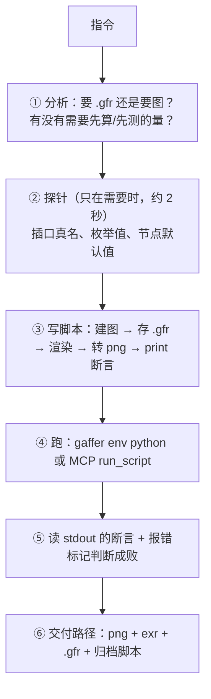

# Gaffer 无头脚本交付（指令 → .gfr / 渲染图）

拿到一句需求，分析完直接写脚本跑，交付文件。**不开 GUI**，也不走逐步驱动 GUI 的工具（那类工具是给"人和 AI 共用一个工作台"设计的，这里不是那个场景）。

## 0. 铁律

- **工作单元是脚本，不是 API 调用**。一段脚本 = 一个任务 = 一个事务，中途失败不留半改的图。
- **`.gfr` 本身就是 Python 脚本** → "写 .gfr" 和 "写脚本" 是同一件事，交付物天然可读可审。
- **插口名一律现场探针**，别凭记忆/文档写（见 §3，这是最高频的翻车点）。
- **输出里出现过报错时，即使出了图也必须复查**（见 §4）。
- **解析公式先问自己适用条件**（正交还是透视、有没有 GI），不成立就数值求解（见 §5）。
- 脚本里**不要加 `if __name__ == "__main__":` 守卫**（screengrab 上下文 `__name__=='builtins'`，且归档脚本要能被直接重跑）。

## 1. 工作流



① 的判断口径：**要"看效果"就出图，要"接着改"就出 .gfr，两个都要就都出**（成本几乎为零，渲染是最慢的一步也只要 2 秒）。数值型需求（"照亮 3/4"、"填满画面 80%"）先想清楚定义，往往需要 §5。

## 2. 命令

```bash
gaffer env python task.py
```

如果有一个包装了上面这条命令的 MCP 工具（例如 `run_script(code=..., label=..., timeout=...)`：把代码写进归档目录、跑完返回 stdout/stderr/exitCode/报错标记），在客户端里用它和直接跑 CLI 是同一条代码路径。CLI 不依赖 MCP 工具是否已挂载，首选它。

产出目录用环境变量传给脚本（例如 `os.environ["GAFFER_OUT"]`），别在脚本里写死路径。

**一次完整往返 1.3–2.7 秒**，所以别怕多跑几次、别怕迭代。

## 3. 探针铁律：插口名只在运行时里

1.6.5.1 的 `StandardOptions.options` 子插口真名带命名空间前缀，而**旧驼峰名只有一部分有兼容别名**——同一个对象里 `opts["renderCamera"]` 能解析（→ `render:camera`），`opts["resolution"]` 直接 KeyError（真名 `render:resolution`）。凭记忆写会随机命中或落空。

```python
print([p.getName() for p in node["options"].children()])          # 插口真名
print([p.getName() for p in node["parameters"].children()])       # 材质/灯光参数
print(node["projection"].getValue(), Gaffer.NodeAlgo.presets(node["projection"]))
```

已探明可直接用：
- `StandardOptions.options`：`render:camera` / `render:resolution`（V2i）/ `render:resolutionMultiplier` / `render:cropWindow` / `render:transformBlur` / `render:deformationBlur` / `render:shutter` / `sampleMotion`（这个没前缀）
- `ArnoldOptions.options`：`aaSamples` / `giDiffuseDepth` / `giSpecularDepth`（无前缀）
- 每个 option 是 NameValuePlug：要 `["enabled"].setValue(True)` **再** `["value"].setValue(x)`

## 4. 静默做错：报错了也可能照样出图

**无头 Gaffer 在单个插口出错后会继续跑完，并写出使用了默认值的结果。** 实测：`resolution` 写错抛 KeyError，512x512 那句没生效，渲染照样出图（默认分辨率），拿到图看不出错。

所以运行结果要单独标记「输出里出现过 Traceback / ERROR / Fatal Python error」（下文称 `hasTrouble`）。**判成败看 `hasTrouble`，不是看 `exitCode`，更不是看"有没有产出文件"。**

写脚本时配合：关键设置**不要**包 try（让它炸），可选设置包 try 但**打印 `WARN` 而不是 traceback**（避免误触发 hasTrouble）。

## 5. 解析公式失效 → 数值求解 + 已知答案校准

下面是一个实例，可直接套用到任何"让画面里某个量等于 X"的需求。

**先问公式的适用条件**。"平行光照亮球 3/4"用月相公式 `lit = (1+cosθ)/2` 得 θ=60°，但那个公式假设**正交投影**。实际透视相机（球心距 6.12、半径 1）只能看到半角 `arccos(R/d)=80.59°` 的球冠而非半球，60° 摆下去像素实测 **0.8148**，超 6.5%。

**测量方法自己也有系统偏差**。用 `Grade(multiply=1e6, whiteClamp)` 把非零亮度推成 1、再 `ImageStats` 求平均来数亮部像素，会把球轮廓上抗锯齿的半覆盖像素算成全亮 → 高估。

**解法：拿一个理论值已知的 case 量出偏差，再校正未知 case。**

1. 正交相机 + θ=60°（月相公式严格成立）→ 实测 0.7687 → δ = +0.0187（正交光圈调到让球在画面里占比与透视一致，边缘影响才可比）
2. 透视相机下二分搜索 θ，目标 = 0.75 + δ
3. 结果 θ=65.20°，实测 0.7697，扣 δ 后 0.7510，误差 0.1%

二分 7 次 + 校准 1 次 = 8 次渲染，总共 4.5 秒。**把渲染 + 测量写成一个函数在同一个脚本里循环**，只启动一次 Gaffer。

配套细节：
- 验证渲染要**排除干扰项**：关 GI（`giDiffuseDepth=0`/`giSpecularDepth=0`）、不放地面、材质 `specular=0`，只留要测的那一项。
- 灯 `angle=0` 让明暗界线锐利，否则界线是渐变的、比例没有确定值。
- 定义要写进交付说明：这里"亮部"= 被平行光**直接**打到（N·L>0），不含 GI 反弹；主图可以开 GI（那是渲染质量，不改变几何事实）。
- **`ImageReader` 有缓存** → 循环里每次换输出文件名（或改 `refreshCount`），否则测的一直是第一张。

## 6. 坑位清单（都实测）

- **UI 元数据无头下为空**：`Metadata.value(node, "nodeGadget:color")` → `None`（只在 GUI 启动脚本里注册）。节点颜色/注释要显式写，或改走 `gaffer screengrab -commandFile x.py -image out.png`（先跑完 gui 启动脚本）。
- **Arnold `loadShader` 在无头下不崩**（实测 `standard_surface` 66 参数、`point_light` 20 参数），别为此把简单任务改成 screengrab。
- **`.gfr` 里渲染节点序列化成 `GafferScene.Render`**（1.6 统一了渲染节点，renderer 走参数），打开仍是 Arnold，重渲字节数一致。
- **`Outputs` 改输出路径别猜子插口名**：`root["Outputs"]["outputs"].children()[0]["fileName"]`。
- **`IECoreScene.Output(path, "exr", "rgba", {})`** 是 1.6 的构造形式（老版本在 `IECore.Display`，要兼容老版本时按 `AttributeError` 分支）。
- **Plane 默认是立面**（XY 平面法线 +Z），转地面 `rotate=(-90,0,0)`。
- **灯光/相机默认朝 -Z**：绕 X 转 α 使 `(0,0,-1) → (0, sinα, -cosα)`，所以要让方向仰角为 e 就设 `rotateX = -e`。
- **球坐在平面上** = 球心抬到 `y=radius`（不是目测），底部 `y=0` 精确相切。
- 渲出的 exr 是线性 HDR，转 png 给人看：`ImageReader → ImageWriter`（png 自动做 sRGB 转换），顺手挂 `ImageStats` 打 `average`/`max` 自查曝光。

## 7. 交付规范

一次任务交四样，直接给文件路径（不要做 base64 内嵌或图集页面）：

- `<name>.png`：512x512 sRGB，直接看这张
- `<name>.exr`：线性 HDR
- `<name>.gfr`：打开即可渲（验一次：load + 换输出路径重渲，字节数应一致）
- `scripts/<时间>_<标签>_<摘要>.py`：归档脚本，可复审、改一行重跑、换镜头复用

脚本末尾 `print` 出关键断言（几何数值、场景路径、文件大小、曝光统计）。**模型看不了图时，stdout 的断言就是唯一的验证手段**；图交给人看。

交付说明里写清：定义口径（如"亮部=直接光"）、数值是推导还是实测、以及一句"改哪个参数能调什么"（如 `intensity=3.0` 调曝光）。

## 8. 和其他技能的关系

- `gaffer-probe`：无源码模块 `dir()` 内省、GUI 对话框 screengrab 抓图。**要抓 GUI 截图或探测编译模块内部时用它**；本技能只管无头生产交付。
- `gaffer-node-docs`：出教学文档用的 Viewer 前后对比图 / GIF 管线。
- 逐步驱动 GUI 的 MCP 工具：只在"人开着 Gaffer、要在他那张图上动手"时用。
